# TOÀN BỘ 21 BIỂU ĐỒ HOẠT ĐỘNG (UML ACTIVITY DIAGRAM)
## DỰ ÁN: ỨNG DỤNG CHĂM SÓC NGƯỜI CAO TUỔI (GERIATRICCARE)
### Chuẩn hóa theo mẫu đồ án: Phân làn 2 cột (Người dùng - Hệ thống), rẽ nhánh xác nhận/huỷ, kiểm tra true/false

---

### UC01: Đăng ký tài khoản
*File PlantUML:* [`UC01_DangKy.puml`](file:///d:/Android/Project/Geriatriccare/docs/plantuml/activity_21_usecases/UC01_DangKy.puml)

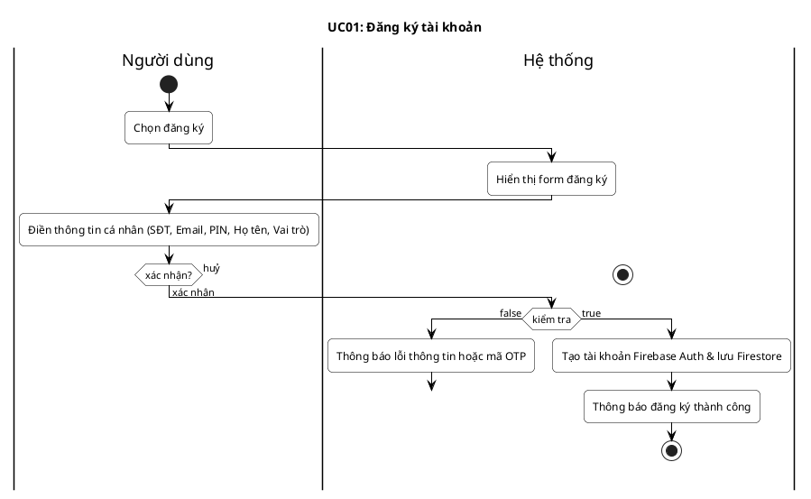

---

### UC02: Đăng nhập
*File PlantUML:* [`UC02_DangNhap.puml`](file:///d:/Android/Project/Geriatriccare/docs/plantuml/activity_21_usecases/UC02_DangNhap.puml)

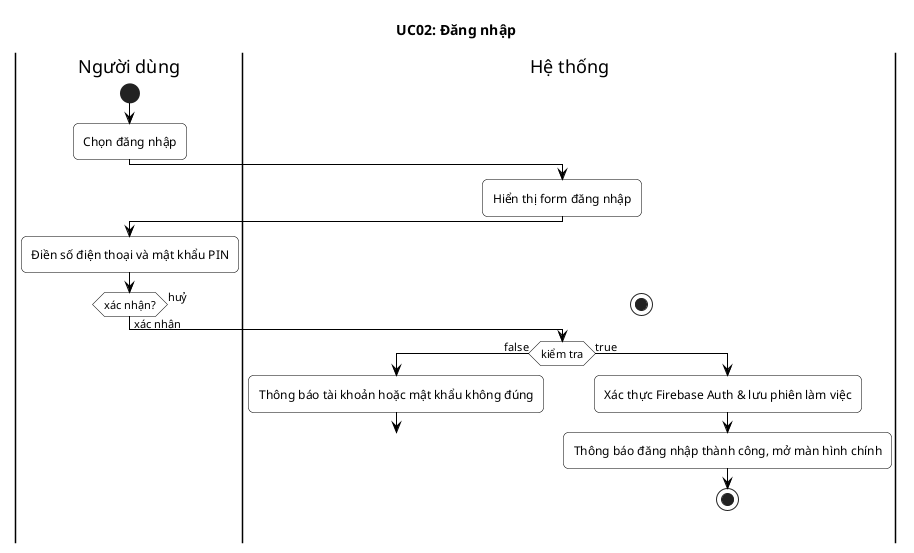

---

### UC03: Đăng xuất
*File PlantUML:* [`UC03_DangXuat.puml`](file:///d:/Android/Project/Geriatriccare/docs/plantuml/activity_21_usecases/UC03_DangXuat.puml)

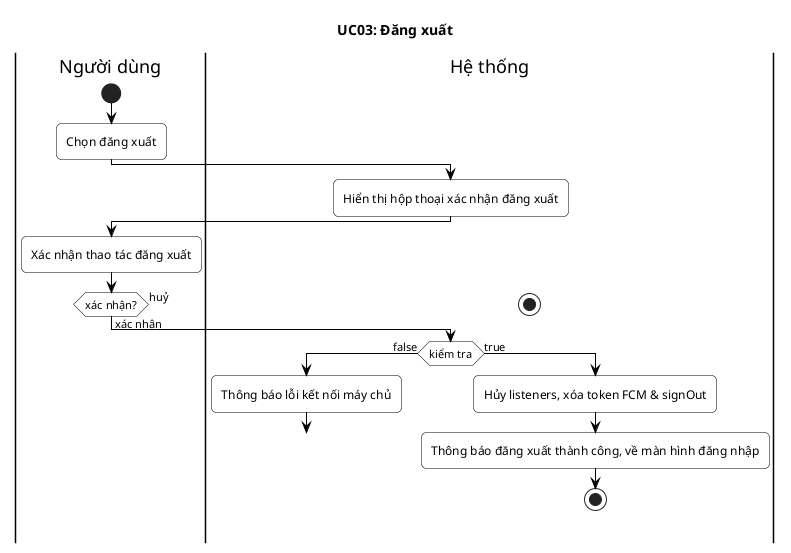

---

### UC04: Gửi cảnh báo SOS
*File PlantUML:* [`UC04_GuiCanhBaoSOS.puml`](file:///d:/Android/Project/Geriatriccare/docs/plantuml/activity_21_usecases/UC04_GuiCanhBaoSOS.puml)

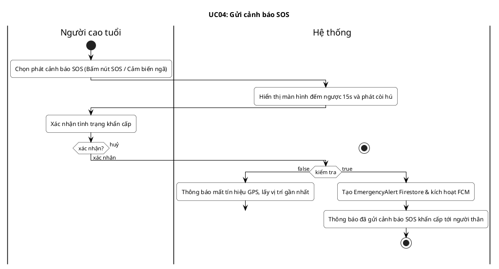

---

### UC05: Tiếp nhận cảnh báo
*File PlantUML:* [`UC05_TiepNhanCanhBao.puml`](file:///d:/Android/Project/Geriatriccare/docs/plantuml/activity_21_usecases/UC05_TiepNhanCanhBao.puml)

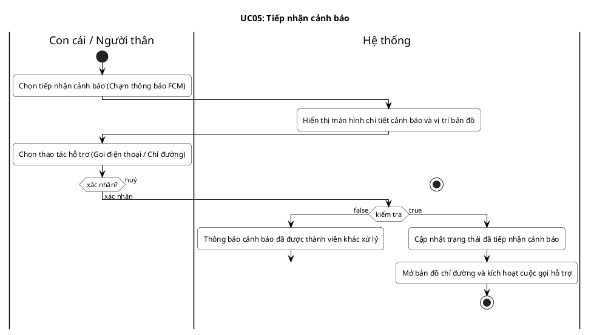

---

### UC06: Xử lý cảnh báo
*File PlantUML:* [`UC06_XuLyCanhBao.puml`](file:///d:/Android/Project/Geriatriccare/docs/plantuml/activity_21_usecases/UC06_XuLyCanhBao.puml)

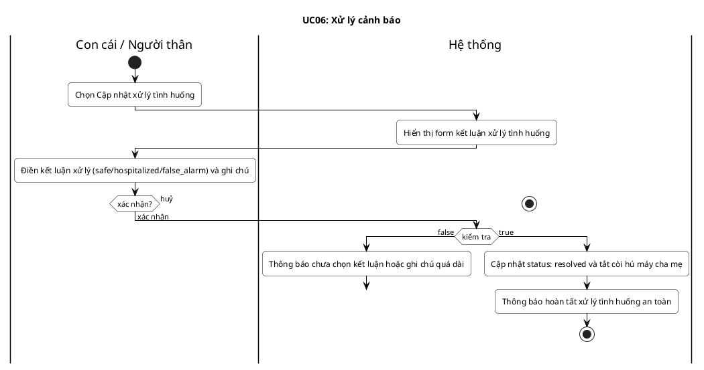

---

### UC07: Ghi chỉ số huyết áp
*File PlantUML:* [`UC07_GhiChiSoHuyetAp.puml`](file:///d:/Android/Project/Geriatriccare/docs/plantuml/activity_21_usecases/UC07_GhiChiSoHuyetAp.puml)

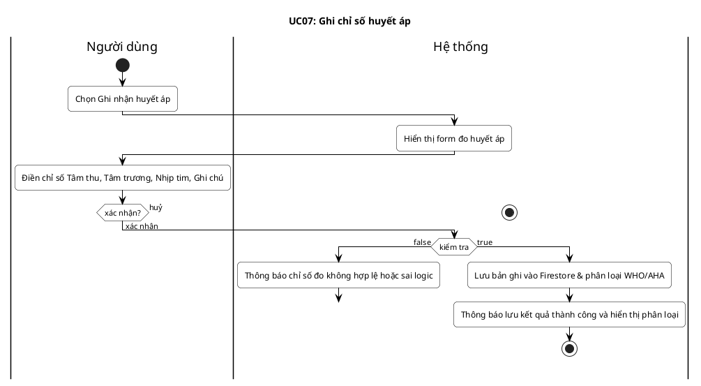

---

### UC08: Theo dõi lịch sử huyết áp
*File PlantUML:* [`UC08_TheoDoiLichSuHuyetAp.puml`](file:///d:/Android/Project/Geriatriccare/docs/plantuml/activity_21_usecases/UC08_TheoDoiLichSuHuyetAp.puml)

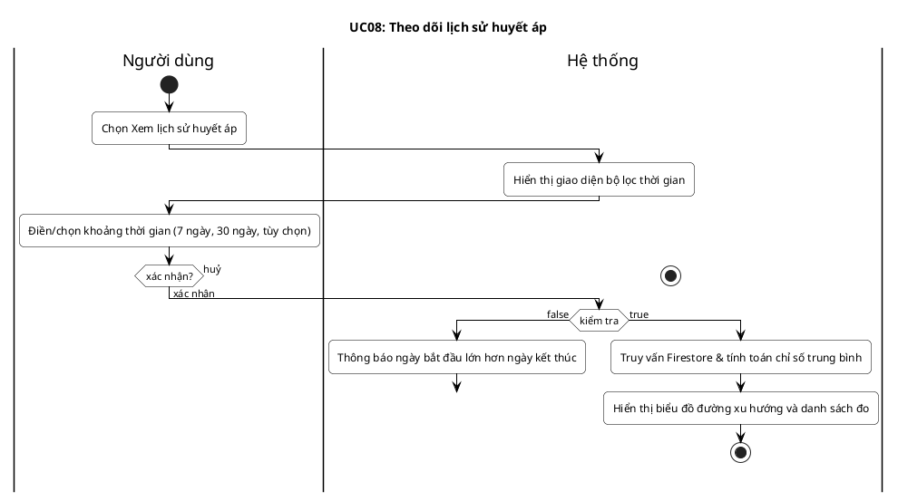

---

### UC09: Cảnh báo chỉ số bất thường
*File PlantUML:* [`UC09_CanhBaoChiSoBatThuong.puml`](file:///d:/Android/Project/Geriatriccare/docs/plantuml/activity_21_usecases/UC09_CanhBaoChiSoBatThuong.puml)

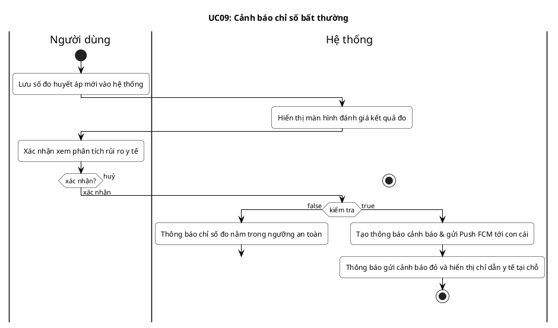

---

### UC10: Thiết lập lịch uống thuốc
*File PlantUML:* [`UC10_ThietLapLichUongThuoc.puml`](file:///d:/Android/Project/Geriatriccare/docs/plantuml/activity_21_usecases/UC10_ThietLapLichUongThuoc.puml)

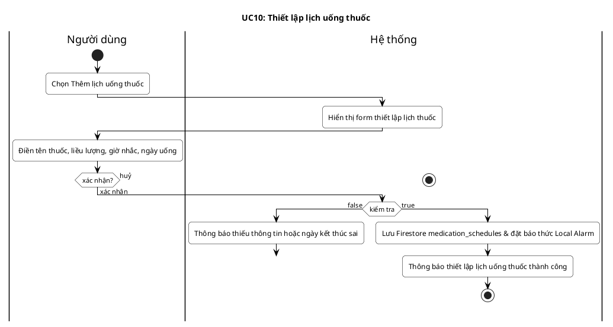

---

### UC11: Nhắc nhở và theo dõi theo ngày
*File PlantUML:* [`UC11_NhacNhoTheoDoiTheoNgay.puml`](file:///d:/Android/Project/Geriatriccare/docs/plantuml/activity_21_usecases/UC11_NhacNhoTheoDoiTheoNgay.puml)

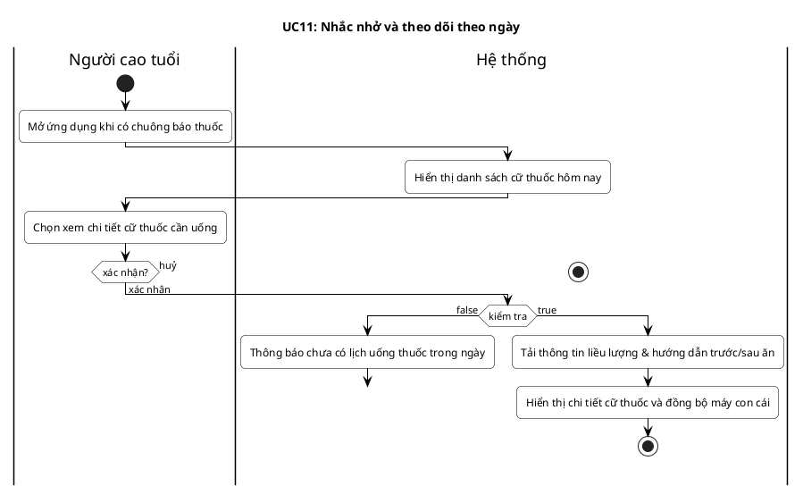

---

### UC12: Ghi nhận nhật ký uống thuốc
*File PlantUML:* [`UC12_GhiNhanNhatKyUongThuoc.puml`](file:///d:/Android/Project/Geriatriccare/docs/plantuml/activity_21_usecases/UC12_GhiNhanNhatKyUongThuoc.puml)


---

### UC13: Gửi và phản hồi yêu cầu liên kết
*File PlantUML:* [`UC13_GuiPhanHoiYeuCauLienKet.puml`](file:///d:/Android/Project/Geriatriccare/docs/plantuml/activity_21_usecases/UC13_GuiPhanHoiYeuCauLienKet.puml)

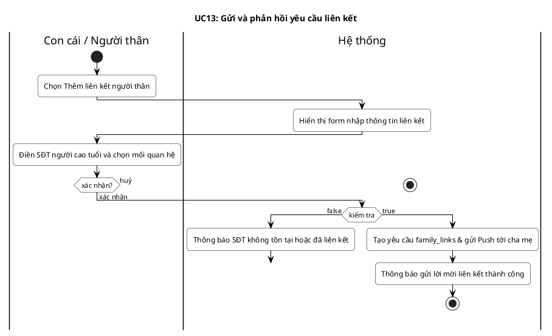

---

### UC14: Quản lý danh sách người thân
*File PlantUML:* [`UC14_QuanLyDanhSachNguoiThan.puml`](file:///d:/Android/Project/Geriatriccare/docs/plantuml/activity_21_usecases/UC14_QuanLyDanhSachNguoiThan.puml)

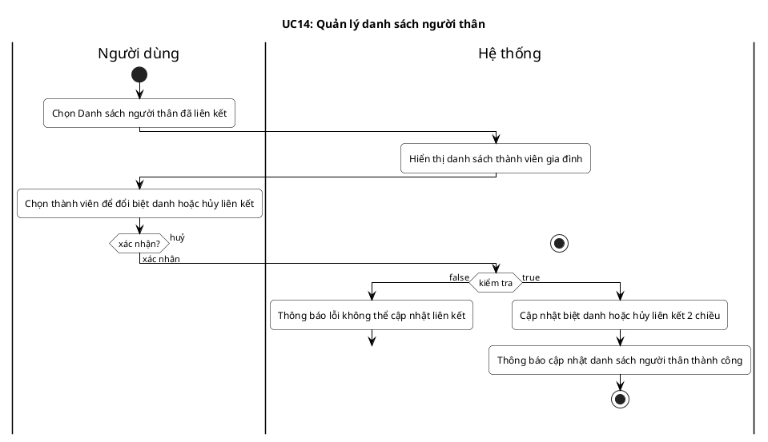

---

### UC15: Liên hệ khẩn cấp
*File PlantUML:* [`UC15_LienHeKhanCap.puml`](file:///d:/Android/Project/Geriatriccare/docs/plantuml/activity_21_usecases/UC15_LienHeKhanCap.puml)

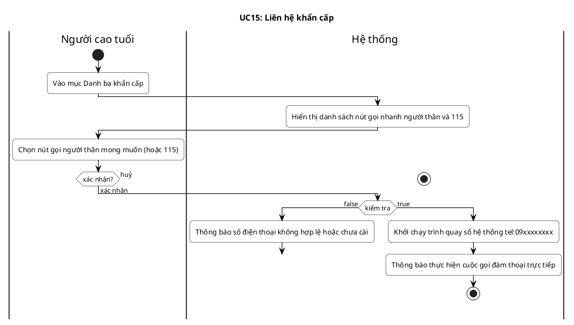

---

### UC16: Tạo lịch khám sức khỏe
*File PlantUML:* [`UC16_TaoLichKhamSucKhoe.puml`](file:///d:/Android/Project/Geriatriccare/docs/plantuml/activity_21_usecases/UC16_TaoLichKhamSucKhoe.puml)

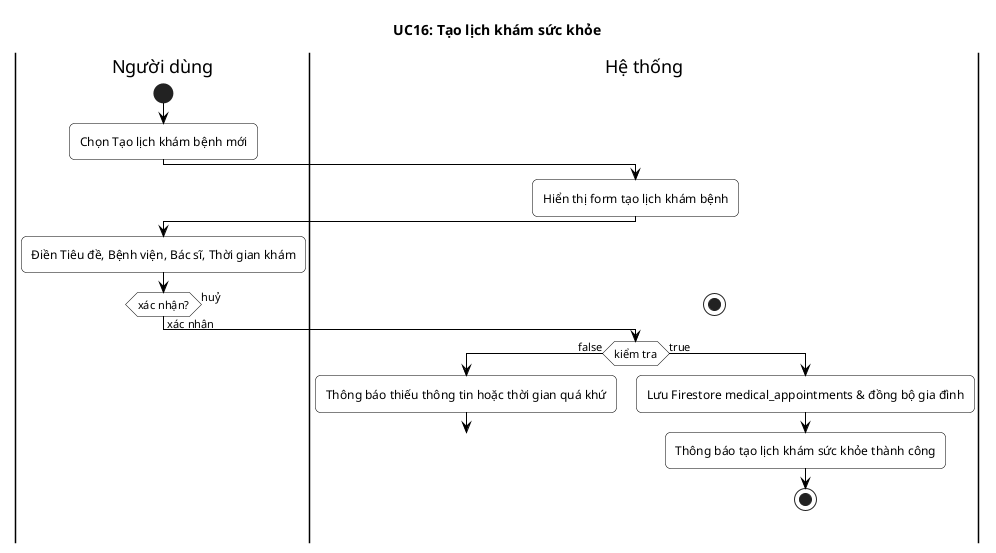

---

### UC17: Điều phối người đưa đi khám
*File PlantUML:* [`UC17_DieuPhoiNguoiDuaDiKham.puml`](file:///d:/Android/Project/Geriatriccare/docs/plantuml/activity_21_usecases/UC17_DieuPhoiNguoiDuaDiKham.puml)

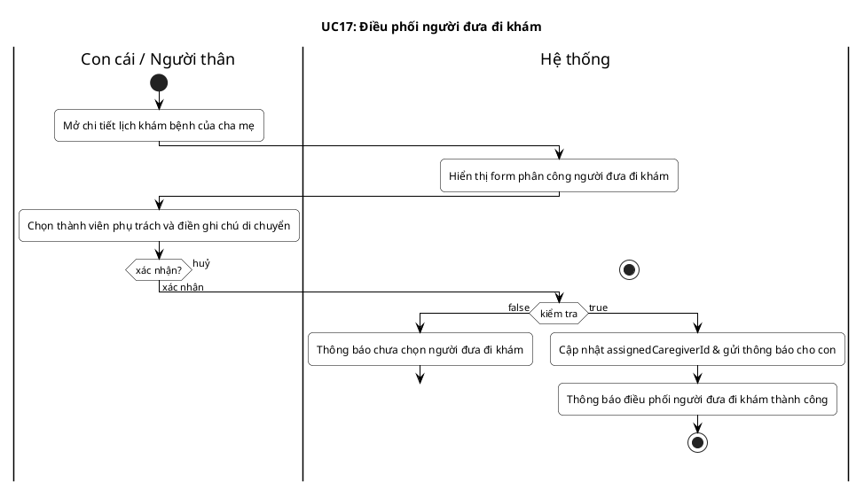

---

### UC18: Xác nhận hoàn tất lịch khám
*File PlantUML:* [`UC18_XacNhanHoanTatLichKham.puml`](file:///d:/Android/Project/Geriatriccare/docs/plantuml/activity_21_usecases/UC18_XacNhanHoanTatLichKham.puml)

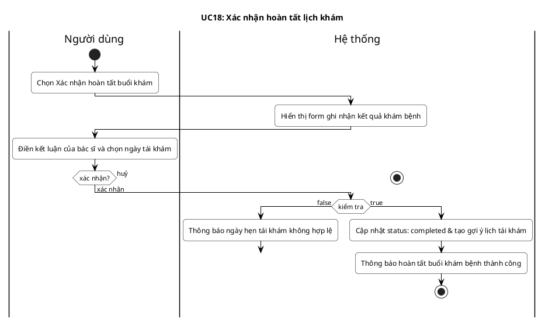

---

### UC19: Lưu hồ sơ y tế
*File PlantUML:* [`UC19_LuuHoSoYTe.puml`](file:///d:/Android/Project/Geriatriccare/docs/plantuml/activity_21_usecases/UC19_LuuHoSoYTe.puml)

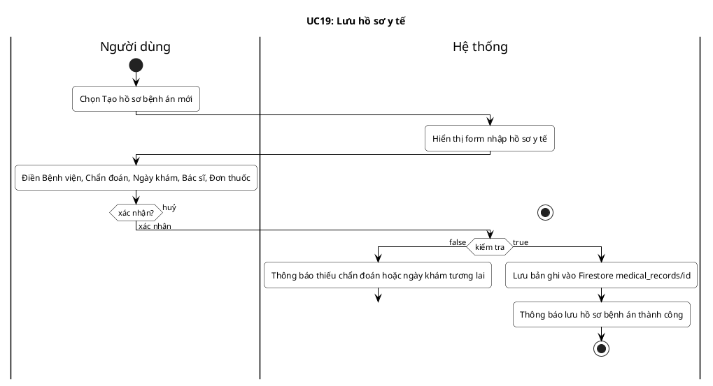

---

### UC20: Quản lý tài liệu đính kèm
*File PlantUML:* [`UC20_QuanLyTaiLieuDinhKem.puml`](file:///d:/Android/Project/Geriatriccare/docs/plantuml/activity_21_usecases/UC20_QuanLyTaiLieuDinhKem.puml)

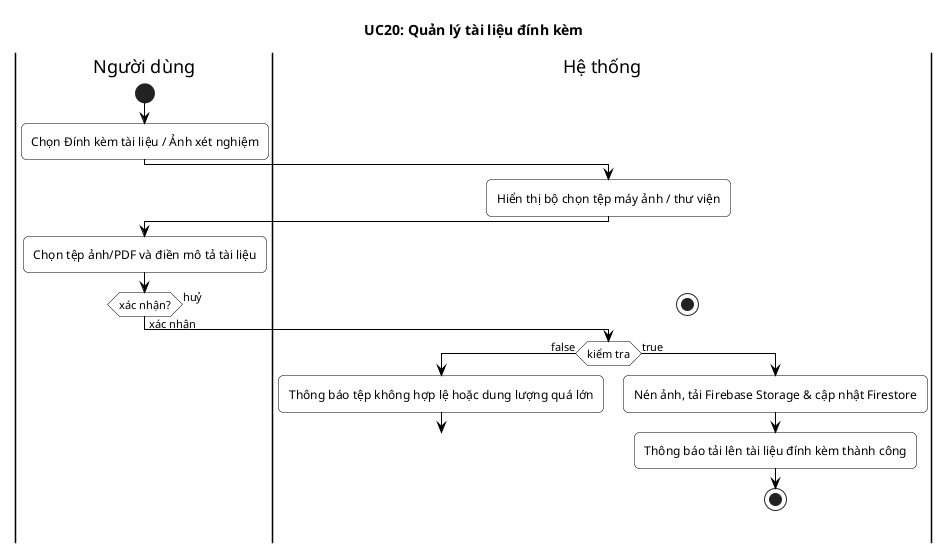

---

### UC21: Tra cứu lịch sử khám bệnh
*File PlantUML:* [`UC21_TraCuuLichSuKhamBenh.puml`](file:///d:/Android/Project/Geriatriccare/docs/plantuml/activity_21_usecases/UC21_TraCuuLichSuKhamBenh.puml)

```plantuml
@startuml Activity_UC21_TraCuuLichSuKhamBenh
skinparam backgroundColor #FFFFFF
skinparam defaultTextAlignment center
skinparam roundCorner 10
skinparam arrowColor #000000
skinparam arrowFontSize 11
skinparam activityBorderColor #000000
skinparam activityBackgroundColor #FFFFFF
skinparam activityDiamondBorderColor #000000
skinparam activityDiamondBackgroundColor #FFFFFF

title UC21: Tra cứu lịch sử khám bệnh

|Người dùng|
start
:Mở Sổ theo dõi khám bệnh / Lịch sử y tế;

|Hệ thống|
label form_UC21
:Hiển thị thanh tìm kiếm và bộ lọc năm khám;

|Người dùng|
:Điền từ khóa tìm kiếm và chọn năm khám;

if (xác nhận?) then (huỷ)
  |Hệ thống|
  stop
else (xác nhận)
  |Hệ thống|
  if (kiểm tra) then (false)
    :Thông báo không tìm thấy hồ sơ bệnh án phù hợp;
    goto form_UC21
  else (true)
    :Lọc kết quả & sắp xếp giảm dần theo ngày khám;
    :Hiển thị danh sách thẻ tóm tắt hồ sơ bệnh án;
    stop
  endif
endif
@enduml
```

---