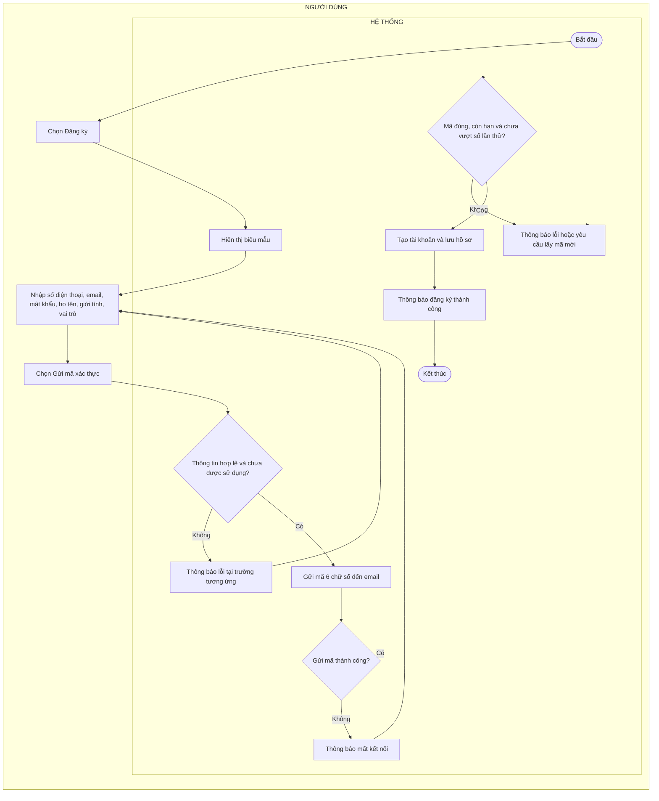
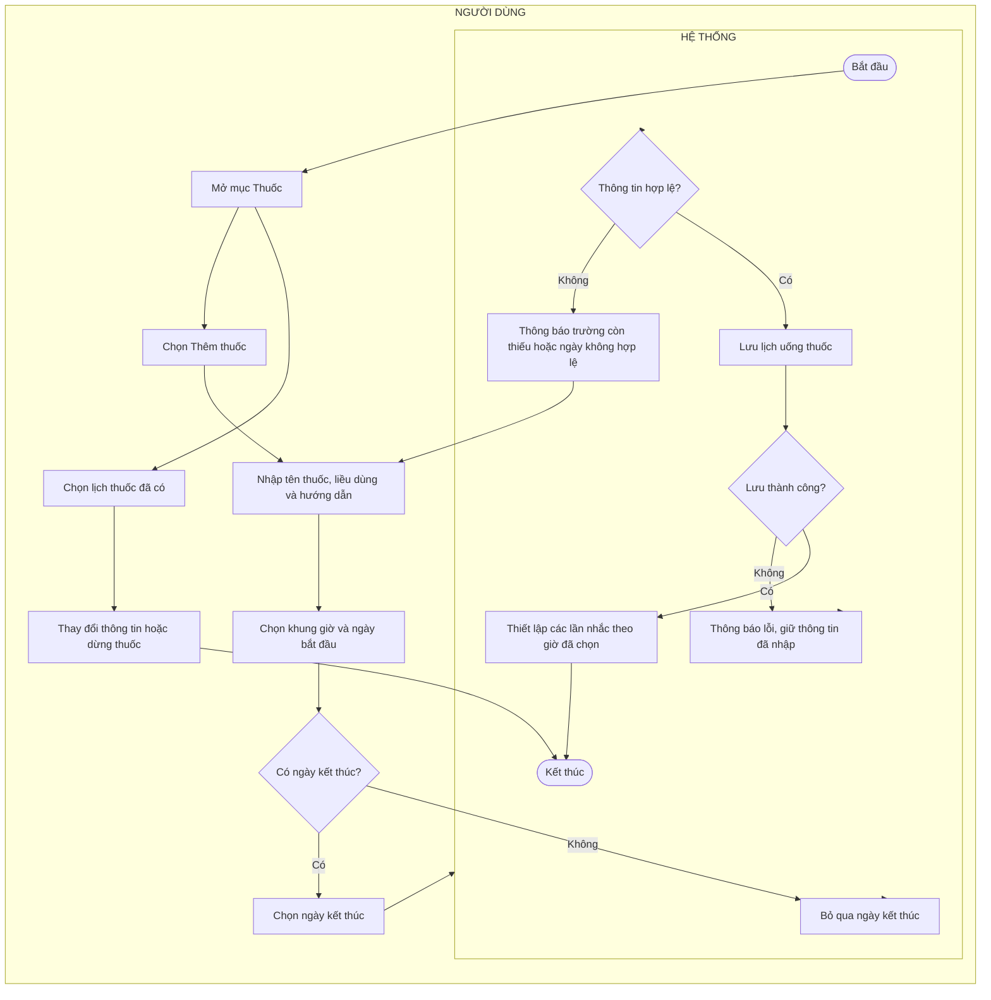
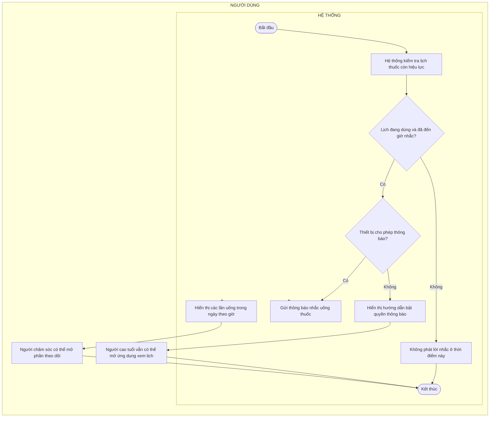
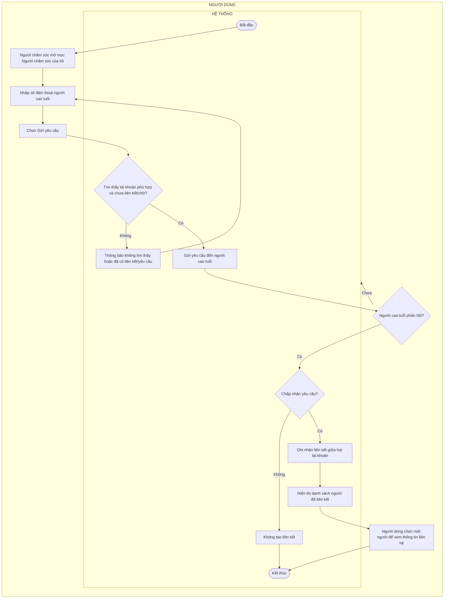

# 3.4. BIỂU ĐỒ HOẠT ĐỘNG CHO CÁC USE CASE

Các sơ đồ dưới đây được dựng từ luồng sự kiện chính, luồng thay thế, ngoại lệ và ràng buộc thông tin trong tài liệu đặc tả. Mỗi sơ đồ được chia thành hai làn: **Người dùng** (người cao tuổi hoặc người chăm sóc) và **Hệ thống**. Các thao tác mở màn hình, nhập dữ liệu, chọn và xác nhận thuộc làn Người dùng; việc kiểm tra, lưu, tải, gửi thông báo, cập nhật và phản hồi tự động thuộc làn Hệ thống. Các mũi tên nối giữa hai làn thể hiện thứ tự tương tác; các nhánh lỗi quay lại bước nhập/thử lại khi đặc tả cho phép.

**Lưu ý về mã:** Tài liệu đặc tả hiện có 17 mục nhưng thiếu UC09 và dùng mã UC15 cho cả “Liên hệ khẩn cấp” lẫn “Quản lý hồ sơ khám và tài liệu”. Vì vậy tiêu đề sơ đồ giữ nguyên số mục 3.3 và mã đang ghi trong đặc tả; cần thống nhất lại mã trước khi đưa vào bản nộp cuối.

## 3.3.1 – UC01 Đăng ký



## 3.3.2 – UC02 Đăng nhập

```mermaid
flowchart LR
  subgraph U["NGƯỜI DÙNG"]
    direction TB
    A[Mở màn hình Đăng nhập]
    B[Nhập số điện thoại và mật khẩu]
    C[Chọn Đăng nhập]
    I[Mở màn hình chính theo vai trò]
  end
  subgraph H["HỆ THỐNG"]
    direction TB
    S([Bắt đầu])
    D{Thông tin hợp lệ?}
    E[Thông báo sai thông tin]
    F{Tài khoản tồn tại và được phép sử dụng?}
    G[Thông báo không tìm thấy tài khoản hoặc không thể đăng nhập]
    H[Tải hồ sơ và vai trò]
    T([Kết thúc])
  end
  S --> A
  A --> B
  B --> C
  C --> D
  D -- Không --> E --> B
  D -- Có --> F
  F -- Không --> G --> B
  F -- Có --> H
  H --> I
  I --> T
```

## 3.3.3 – UC03 Đăng xuất

```mermaid
flowchart LR
  subgraph U["NGƯỜI DÙNG"]
    direction TB
    A[Mở Cài đặt]
    B[Chọn Đăng xuất]
    D{Người dùng xác nhận?}
  end
  subgraph H["HỆ THỐNG"]
    direction TB
    S([Bắt đầu])
    C[Hiển thị xác nhận]
    E[Đóng thông báo, giữ phiên hiện tại]
    T([Kết thúc])
    F[Kết thúc phiên sử dụng]
    G{Đăng xuất thành công?}
    H[Thông báo lỗi]
    I[Chuyển về màn hình đăng nhập]
  end
  S --> A
  A --> B
  B --> C
  C --> D
  D -- Không --> E --> T
  D -- Có --> F
  F --> G
  G -- Không --> H --> C
  G -- Có --> I
  I --> T
```

## 3.3.4 – UC04 Chỉnh sửa thông tin cá nhân

```mermaid
flowchart LR
  subgraph U["NGƯỜI DÙNG"]
    direction TB
    A[Mở Cài đặt]
    B[Chọn Chỉnh sửa hồ sơ]
    D[Thay đổi họ tên hoặc giới tính]
    E[Chọn Lưu thay đổi]
  end
  subgraph H["HỆ THỐNG"]
    direction TB
    S([Bắt đầu])
    C[Hiển thị họ tên và giới tính hiện tại]
    F{Họ tên và giới tính hợp lệ?}
    G[Thông báo họ tên không hợp lệ]
    H[Lưu thông tin]
    I{Lưu thành công?}
    J[Thông báo lỗi, giữ nội dung đã nhập]
    K[Thông báo cập nhật thành công]
    T([Kết thúc])
  end
  S --> A
  A --> B
  B --> C
  C --> D
  D --> E
  E --> F
  F -- Không --> G --> D
  F -- Có --> H
  H --> I
  I -- Không --> J --> D
  I -- Có --> K
  K --> T
```

## 3.3.5 – UC05 Gửi cảnh báo SOS

```mermaid
flowchart LR
  subgraph U["NGƯỜI DÙNG"]
    direction TB
    B[Chọn nút SOS]
    D{Người cao tuổi chọn Tôi vẫn ổn?}
  end
  subgraph H["HỆ THỐNG"]
    direction TB
    S([Bắt đầu])
    A{Cách phát hiện sự cố?}
    C[Hiển thị câu hỏi xác nhận và đếm ngược]
    E[Đóng thông báo, không gửi cảnh báo]
    T([Kết thúc])
    F[Ghi nhận cảnh báo và thời điểm]
    G[Lấy vị trí nếu thiết bị cho phép]
    H[Gửi thông báo đến người chăm sóc đã liên kết]
    I{Gửi thông báo thành công?}
    J[Hiển thị đã gửi cảnh báo]
    K[Thông báo chưa gửi được, hiển thị lựa chọn gọi 115]
  end
  S --> A
  A -- Người cao tuổi chủ động --> B
  A -- Thiết bị phát hiện dấu hiệu té ngã --> C
  C --> D
  D -- Có --> E --> T
  D -- Không hoặc hết giờ --> F
  B --> F
  F --> G
  G --> H
  H --> I
  I -- Có --> J --> T
  I -- Không --> K
  K --> T
```

## 3.3.6 – UC06 Tiếp nhận và xử lý cảnh báo

```mermaid
flowchart LR
  subgraph U["NGƯỜI DÙNG"]
    direction TB
    A[Người chăm sóc nhận thông báo SOS]
    B[Mở thông báo]
    F[Chọn Tiếp nhận]
    J[Thực hiện hỗ trợ: gọi người cao tuổi, gọi 115 hoặc mở bản đồ]
    M[Chọn Kết thúc cảnh báo]
    N[Chọn kết quả hỗ trợ và nhập ghi chú nếu cần]
  end
  subgraph H["HỆ THỐNG"]
    direction TB
    S([Bắt đầu])
    C[Hiển thị người gặp sự cố, thời điểm, nguyên nhân, số điện thoại và vị trí nếu có]
    D{Có quyền xem và cảnh báo còn hiệu lực?}
    E[Thông báo không thể xử lý cảnh báo]
    T([Kết thúc])
    G{Người khác đã tiếp nhận trước?}
    H[Hiển thị người đang xử lý và dữ liệu mới nhất]
    I[Ghi nhận người tiếp nhận, báo cho người chăm sóc liên quan]
    K{Đã liên hệ hoặc hỗ trợ?}
    L[Tiếp tục gọi 115 hoặc nhờ người ở gần hỗ trợ]
    O[Lưu kết quả và kết thúc cảnh báo]
    P{Lưu thành công?}
    Q[Thông báo lỗi, giữ cảnh báo chờ kết thúc]
    R[Thông báo kết quả cho người chăm sóc liên quan]
  end
  S --> A
  A --> B
  B --> C
  C --> D
  D -- Không --> E --> T
  D -- Có --> F
  F --> G
  G -- Có --> H --> T
  G -- Không --> I
  I --> J
  J --> K
  K -- Chưa --> L --> J
  K -- Rồi --> M
  M --> N
  N --> O
  O --> P
  P -- Không --> Q --> N
  P -- Có --> R
  R --> T
```

## 3.3.7 – UC07 Ghi chỉ số và theo dõi cảnh báo huyết áp

```mermaid
flowchart LR
  subgraph U["NGƯỜI DÙNG"]
    direction TB
    A[Mở Nhật ký sức khỏe]
    B[Chọn Ghi chỉ số]
    D[Nhập huyết áp trên và huyết áp dưới]
    E[Chọn Lưu kết quả đo]
  end
  subgraph H["HỆ THỐNG"]
    direction TB
    S([Bắt đầu])
    C[Hiển thị màn hình nhập kết quả]
    F{Hai chỉ số nằm trong khoảng cho phép và huyết áp trên lớn hơn huyết áp dưới?}
    G[Thông báo chỉ số chưa hợp lệ]
    H[Lưu kết quả đo]
    I{Lưu thành công?}
    J[Thông báo lỗi và cho phép thử lại]
    K[Đánh giá mức độ và hiển thị hướng dẫn]
    L[Hiển thị kết quả trong lịch sử]
    T([Kết thúc])
  end
  S --> A
  A --> B
  B --> C
  C --> D
  D --> E
  E --> F
  F -- Không --> G --> D
  F -- Có --> H
  H --> I
  I -- Không --> J --> E
  I -- Có --> K
  K --> L
  L --> T
```

## 3.3.8 – UC08 Theo dõi lịch sử huyết áp

```mermaid
flowchart LR
  subgraph U["NGƯỜI DÙNG"]
    direction TB
    A[Mở Nhật ký sức khỏe]
    G[Người dùng chọn một lần đo]
  end
  subgraph H["HỆ THỐNG"]
    direction TB
    S([Bắt đầu])
    B[Tải các lần đo đã lưu]
    C{Có dữ liệu?}
    D[Hiển thị hướng dẫn ghi chỉ số lần đầu]
    T([Kết thúc])
    E[Hiển thị biểu đồ tối đa 7 lần đo gần nhất]
    F[Hiển thị danh sách từ mới nhất đến cũ nhất]
    H[Hiển thị chi tiết và mức đánh giá]
  end
  S --> A
  A --> B
  B --> C
  C -- Không --> D --> T
  C -- Có --> E
  E --> F
  F --> G
  G --> H
  H --> T
```

## 3.3.10 – UC10 Thiết lập lịch uống thuốc



## 3.3.11 – UC11 Nhắc nhở và theo dõi lịch uống thuốc



## 3.3.12 – UC12 Ghi nhận nhật ký uống thuốc

```mermaid
flowchart LR
  subgraph U["NGƯỜI DÙNG"]
    direction TB
    A[Người cao tuổi mở mục Thuốc]
    C[Chọn Đã uống tại lần uống tương ứng]
    F[Ghi thời điểm xác nhận]
    J[Người chăm sóc xem thông tin cập nhật]
    K[Hệ thống kiểm tra liều quá giờ 5 tiếng chưa xác nhận]
  end
  subgraph H["HỆ THỐNG"]
    direction TB
    S([Bắt đầu])
    B[Hiển thị các lần uống trong ngày]
    D{Lần uống đã được ghi nhận chưa?}
    E[Không tạo bản ghi trùng]
    T([Kết thúc])
    G{Lưu thành công?}
    H[Thông báo lỗi và cho phép thử lại]
    I[Cập nhật lần uống thành đã uống]
    L[Đánh dấu liều quá hạn là bỏ lỡ]
  end
  S --> A
  A --> B
  B --> C
  C --> D
  D -- Có --> E --> T
  D -- Không --> F
  F --> G
  G -- Không --> H --> C
  G -- Có --> I
  I --> J
  J --> K
  K --> L
  L --> T
```

## 3.3.13 – UC13 Liên kết và quản lý người chăm sóc



## 3.3.15 – UC15 Liên hệ khẩn cấp

```mermaid
flowchart LR
  subgraph U["NGƯỜI DÙNG"]
    direction TB
    A[Mở mục Liên hệ khẩn cấp]
    C[Chọn Gọi 115]
    E{Người dùng xác nhận gọi?}
    G[Thiết bị mở chức năng gọi điện]
    J[Người dùng thực hiện cuộc gọi 115]
  end
  subgraph H["HỆ THỐNG"]
    direction TB
    S([Bắt đầu])
    B[Hiển thị nút gọi 115 và người chăm sóc đã liên kết]
    D[Hiển thị thông báo xác nhận]
    F[Đóng thông báo, không gọi]
    T([Kết thúc])
    H{Thiết bị hỗ trợ gọi?}
    I[Thông báo không thể thực hiện cuộc gọi]
  end
  S --> A
  A --> B
  B --> C
  C --> D
  D --> E
  E -- Không --> F --> T
  E -- Có --> G
  G --> H
  H -- Không --> I --> T
  H -- Có --> J
  J --> T
```

## 3.3.14 – UC14 Quản lý lịch khám gia đình

```mermaid
flowchart LR
  subgraph U["NGƯỜI DÙNG"]
    direction TB
    A[Mở mục Lịch khám]
    B[Chọn Thêm lịch]
    C[Nhập nội dung khám, cơ sở y tế, khoa, thời gian và ghi chú]
    D[Chọn người dự kiến đưa đi nếu đã xác định]
    E[Chọn Lưu]
    L[Thành viên chọn Tôi sẽ đưa đi]
    Q{Người phụ trách cần trả lịch?}
    R[Chọn Nhờ người khác, bỏ người phụ trách]
    V[Chọn Hoàn thành]
    X[Mở phần thêm hồ sơ khám, điền sẵn cơ sở và ngày khám]
  end
  subgraph H["HỆ THỐNG"]
    direction TB
    S([Bắt đầu])
    F{Thông tin hợp lệ và người phụ trách hợp lệ?}
    G[Thông báo nội dung thiếu hoặc thời gian/người phụ trách không hợp lệ]
    H[Tạo lịch khám]
    I{Lịch có người phụ trách?}
    J[Hiển thị lịch chưa có người nhận]
    K[Hiển thị lịch với người phụ trách]
    M[Theo dõi lịch khám]
    N{Lịch vẫn chưa có người nhận?}
    O[Thông báo người khác đã nhận lịch]
    P[Ghi nhận người phụ trách]
    U{Đã đến hoặc qua giờ hẹn và đúng người phụ trách?}
    W[Cập nhật lịch đã hoàn thành]
    Y{Thêm hồ sơ ngay?}
    T([Kết thúc])
    Z[Chuyển sang chức năng quản lý hồ sơ khám]
  end
  S --> A
  A --> B
  B --> C
  C --> D
  D --> E
  E --> F
  F -- Không --> G --> C
  F -- Có --> H
  H --> I
  I -- Không --> J
  I -- Có --> K
  J --> L
  K --> M
  L --> N
  N -- Không --> O --> M
  N -- Có --> P --> M
  M --> Q
  Q -- Có --> R --> J
  Q -- Không --> U
  U -- Không --> M
  U -- Có --> V
  V --> W
  W --> X
  X --> Y
  Y -- Không --> T
  Y -- Có --> Z
  Z --> T
```

## 3.3.15 – UC15 Quản lý hồ sơ khám và tài liệu

```mermaid
flowchart LR
  subgraph U["NGƯỜI DÙNG"]
    direction TB
    A[Mở mục Hồ sơ khám]
    E{Người dùng muốn thêm?}
    F[Chọn Thêm hồ sơ]
    H{Chọn hồ sơ để xem hay thêm mới?}
    J[Nhập ngày khám, bệnh viện, chẩn đoán và ghi chú nếu có]
    K[Chọn Lưu]
    Q[Mở hồ sơ vừa tạo]
    R[Chọn thêm tài liệu]
    U[Chọn ảnh hoặc PDF]
  end
  subgraph H["HỆ THỐNG"]
    direction TB
    S([Bắt đầu])
    B[Tải danh sách các lần khám]
    C{Có hồ sơ?}
    D[Hiển thị hướng dẫn thêm hồ sơ]
    T([Kết thúc])
    G[Hiển thị lịch sử khám mới nhất trước]
    I[Hiển thị chi tiết và tài liệu đính kèm]
    L{Thông tin hợp lệ và có quyền thêm?}
    M[Thông báo lỗi hoặc thiếu thông tin]
    N[Lưu hồ sơ khám]
    O{Lưu thành công?}
    P[Thông báo lỗi, giữ nội dung đã nhập]
    V{Định dạng đúng và dung lượng dưới 15 MB?}
    W[Thông báo tệp không hợp lệ]
    X[Lưu tài liệu vào hồ sơ]
    Y{Tải tệp thành công?}
    Z[Thông báo lỗi tải tệp]
    AA[Hiển thị tài liệu trong hồ sơ]
  end
  S --> A
  A --> B
  B --> C
  C -- Không --> D --> E
  E -- Không --> T
  E -- Có --> F
  C -- Có --> G
  G --> H
  H -- Xem --> I --> T
  H -- Thêm --> F
  F --> J
  J --> K
  K --> L
  L -- Không --> M --> J
  L -- Có --> N
  N --> O
  O -- Không --> P --> K
  O -- Có --> Q
  Q --> R
  R --> U
  U --> V
  V -- Không --> W --> U
  V -- Có --> X
  X --> Y
  Y -- Không --> Z --> U
  Y -- Có --> AA
  AA --> T
```

## 3.3.16 – UC16 Ghi âm lời nhắc

```mermaid
flowchart LR
  subgraph U["NGƯỜI DÙNG"]
    direction TB
    A[Mở Cài đặt]
    B[Chọn Ghi âm lời nhắc]
    D[Nhập tên lời nhắc nếu muốn]
    E[Chọn Bắt đầu ghi âm]
    I[Người dùng dừng hoặc đạt giới hạn 29 giây]
    L[Nghe lại bản ghi]
    M{Muốn ghi lại?}
    N[Chọn Lưu bản ghi]
    Q{Có đặt làm âm thanh nhắc thuốc trên Android?}
  end
  subgraph H["HỆ THỐNG"]
    direction TB
    S([Bắt đầu])
    C[Hiển thị màn hình ghi âm]
    F{Đã cấp quyền micro?}
    G[Thông báo cần cấp quyền micro]
    T([Kết thúc])
    H[Bắt đầu ghi âm]
    J{Bản ghi có thời lượng lớn hơn 0?}
    K[Yêu cầu ghi âm lại]
    O{Lưu thành công?}
    P[Thông báo lỗi]
    R[Giữ bản ghi trong tài khoản]
    U[Đặt bản ghi làm âm thanh nhắc thuốc]
    V{Đặt âm thanh thành công?}
    W[Thông báo riêng lỗi đặt âm thanh]
  end
  S --> A
  A --> B
  B --> C
  C --> D
  D --> E
  E --> F
  F -- Không --> G --> T
  F -- Có --> H
  H --> I
  I --> J
  J -- Không --> K --> E
  J -- Có --> L
  L --> M
  M -- Có --> E
  M -- Không --> N
  N --> O
  O -- Không --> P --> N
  O -- Có --> Q
  Q -- Không --> R --> T
  Q -- Có --> U
  U --> V
  V -- Không --> W --> T
  V -- Có --> T
```

## 3.3.17 – UC17 Xem vị trí người cao tuổi

```mermaid
flowchart LR
  subgraph U["NGƯỜI DÙNG"]
    direction TB
    A[Người cao tuổi đăng nhập và mở ứng dụng]
    E[Người chăm sóc mở màn hình gia đình]
  end
  subgraph H["HỆ THỐNG"]
    direction TB
    S([Bắt đầu])
    B[Ứng dụng xin quyền và lấy vị trí theo chu kỳ]
    C{Được cấp quyền và lấy được vị trí?}
    D[Không cập nhật vị trí mới]
    F[Lưu vị trí và thời điểm cập nhật]
    G{Có dữ liệu vị trí đã lưu?}
    H[Thông báo chưa có thông tin vị trí]
    T([Kết thúc])
    I[Hiển thị vị trí gần nhất và thời điểm cập nhật]
  end
  S --> A
  A --> B
  B --> C
  C -- Không --> D --> E
  C -- Có --> F
  F --> E
  E --> G
  G -- Không --> H --> T
  G -- Có --> I
  I --> T
```
