# 3.4. BIỂU ĐỒ HOẠT ĐỘNG CHO CÁC USE CASE

Các sơ đồ dưới đây được dựng từ luồng sự kiện chính, luồng thay thế, ngoại lệ và ràng buộc thông tin trong tài liệu đặc tả. Mỗi sơ đồ dùng điểm bắt đầu, điểm kết thúc, hành động và nhánh quyết định. Các nhánh lỗi quay lại bước nhập/thử lại khi đặc tả cho phép.

**Lưu ý về mã:** Tài liệu đặc tả hiện có 17 mục nhưng thiếu UC09 và dùng mã UC15 cho cả “Liên hệ khẩn cấp” lẫn “Quản lý hồ sơ khám và tài liệu”. Vì vậy tiêu đề sơ đồ giữ nguyên số mục 3.3 và mã đang ghi trong đặc tả; cần thống nhất lại mã trước khi đưa vào bản nộp cuối.

## 3.3.1 – UC01 Đăng ký

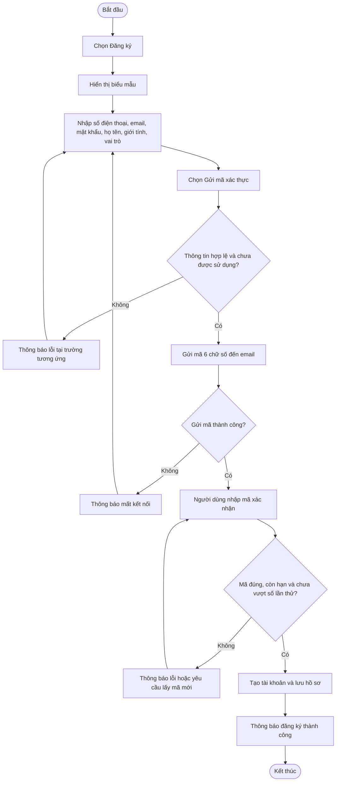

## 3.3.2 – UC02 Đăng nhập

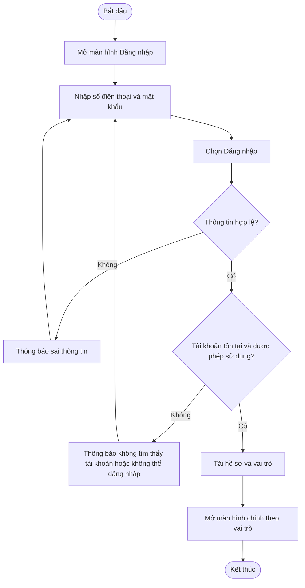

## 3.3.3 – UC03 Đăng xuất

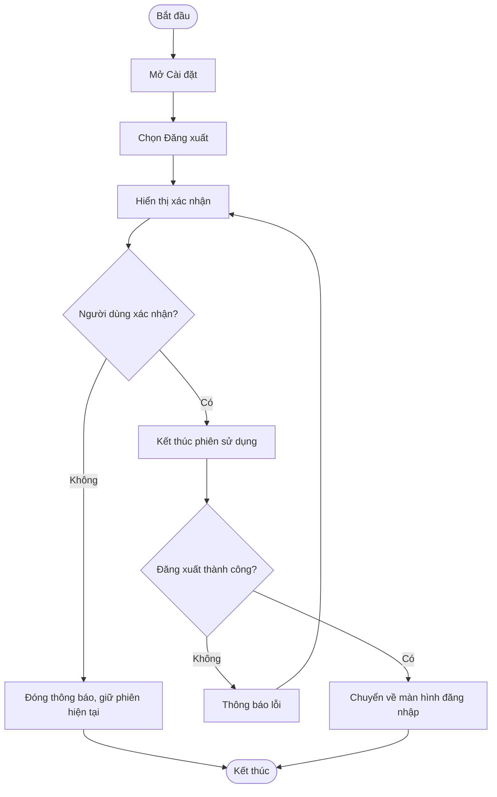

## 3.3.4 – UC04 Chỉnh sửa thông tin cá nhân

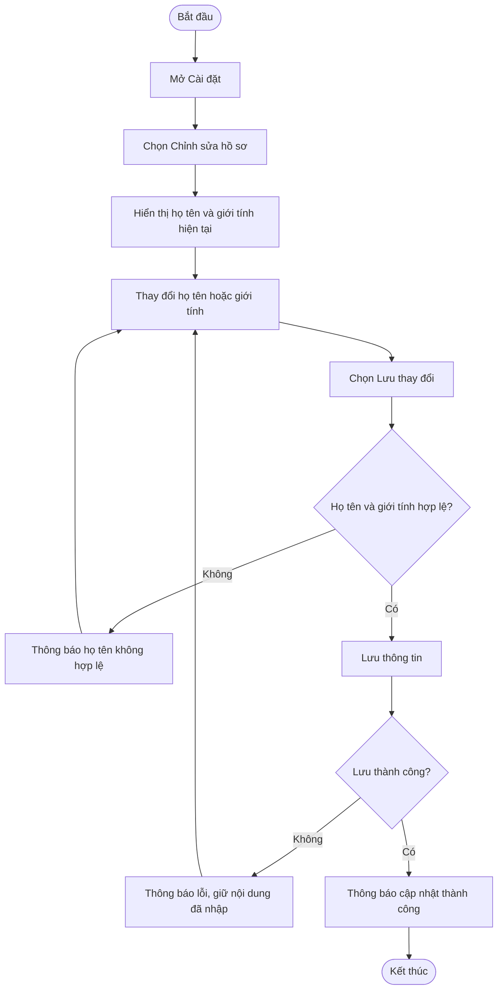

## 3.3.5 – UC05 Gửi cảnh báo SOS

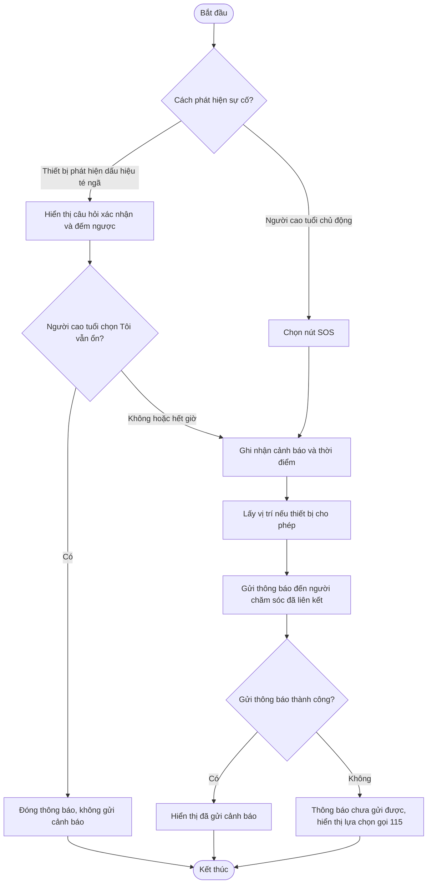

## 3.3.6 – UC06 Tiếp nhận và xử lý cảnh báo

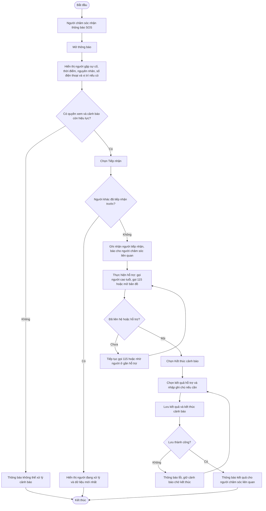

## 3.3.7 – UC07 Ghi chỉ số và theo dõi cảnh báo huyết áp

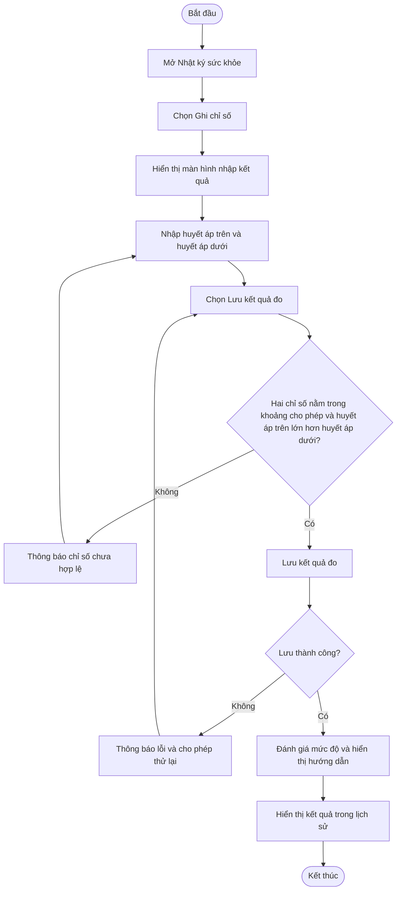

## 3.3.8 – UC08 Theo dõi lịch sử huyết áp

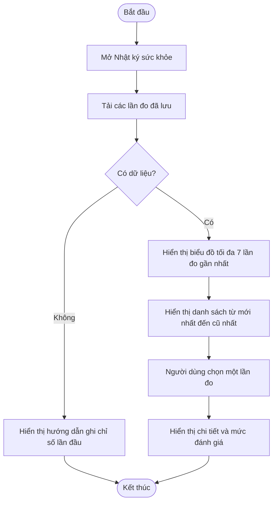

## 3.3.10 – UC10 Thiết lập lịch uống thuốc

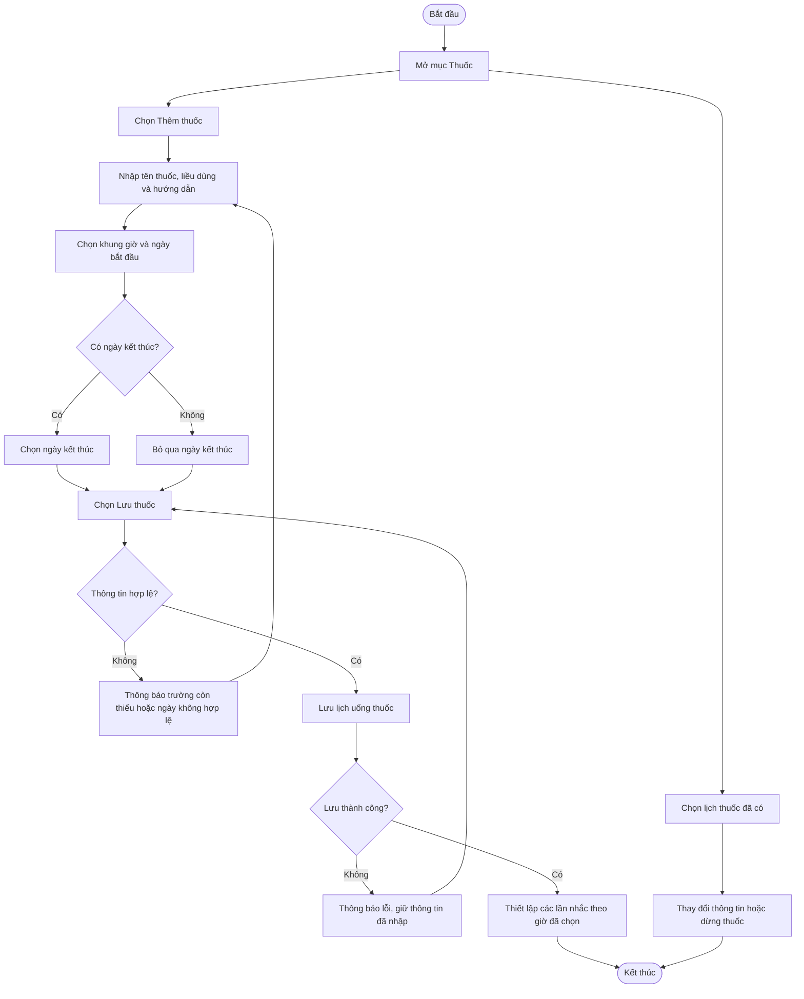

## 3.3.11 – UC11 Nhắc nhở và theo dõi lịch uống thuốc

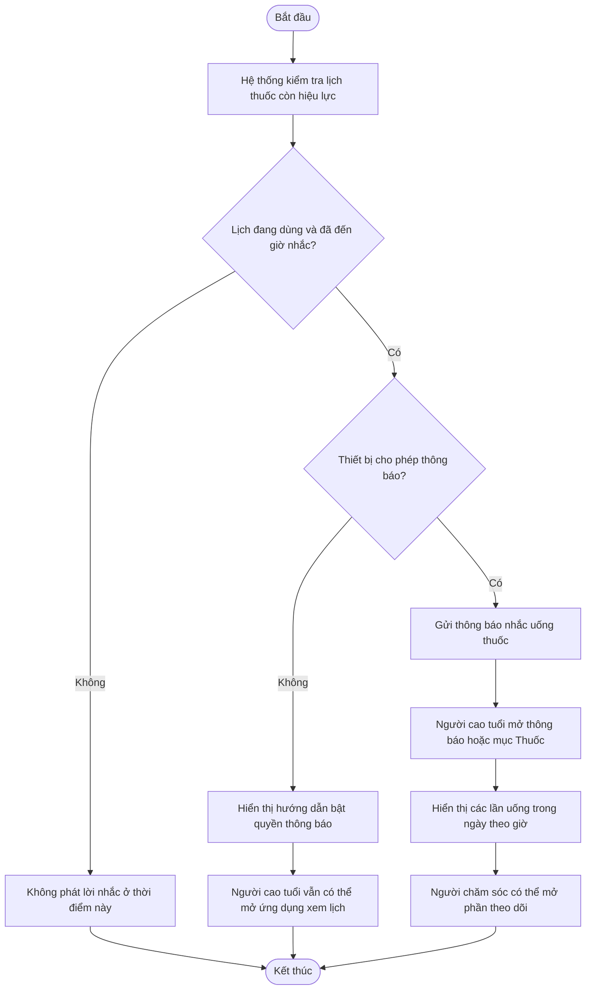

## 3.3.12 – UC12 Ghi nhận nhật ký uống thuốc

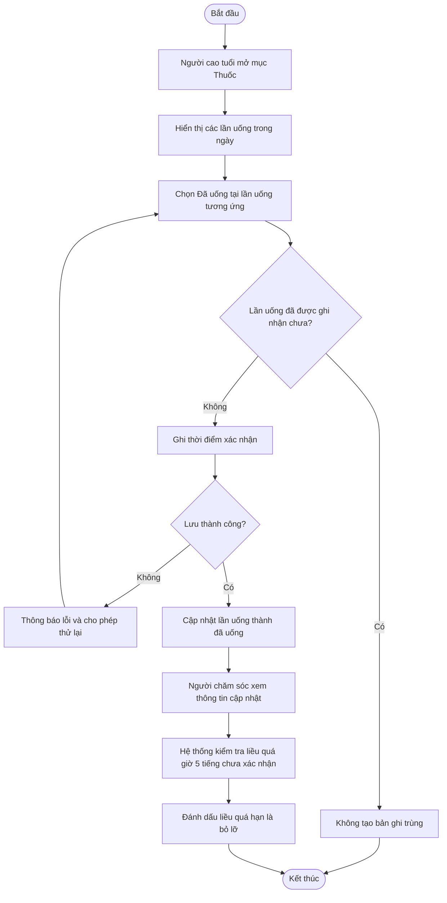

## 3.3.13 – UC13 Liên kết và quản lý người chăm sóc

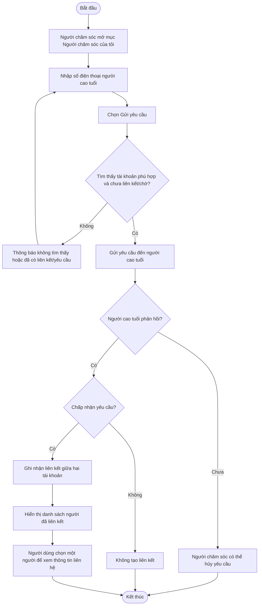

## 3.3.15 – UC15 Liên hệ khẩn cấp

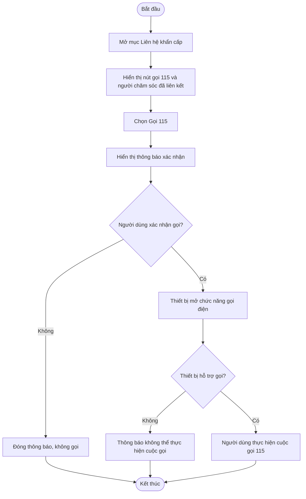

## 3.3.14 – UC14 Quản lý lịch khám gia đình

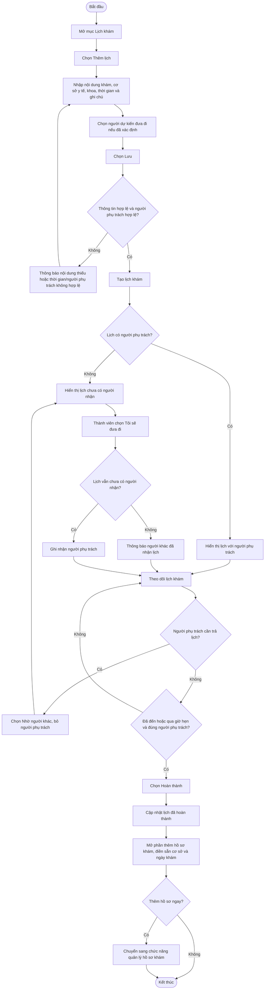

## 3.3.15 – UC15 Quản lý hồ sơ khám và tài liệu

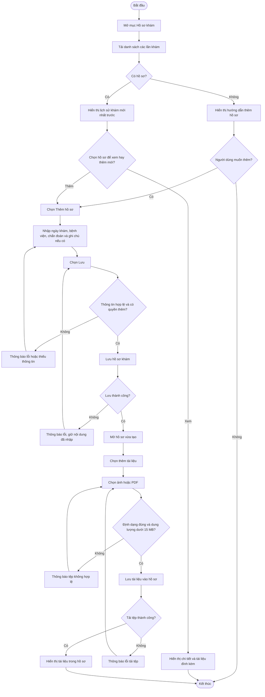

## 3.3.16 – UC16 Ghi âm lời nhắc

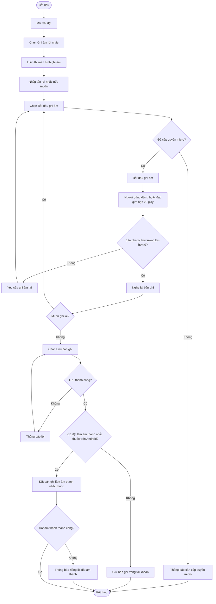

## 3.3.17 – UC17 Xem vị trí người cao tuổi

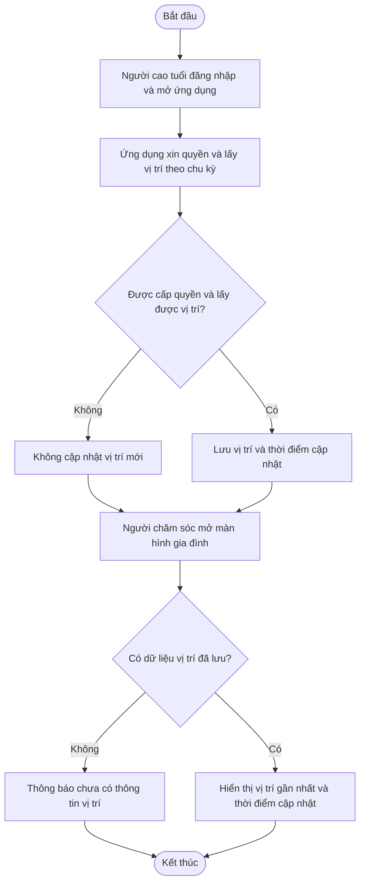
