# BIỂU ĐỒ LỚP CHI TIẾT (CLASS DIAGRAM) - HỆ THỐNG GERIATRICCARE

> **Hệ thống:** Ứng dụng Hỗ trợ và Chăm sóc Sức khỏe Người cao tuổi (Geriatriccare)  
> **Kiến trúc:** Clean Architecture (Domain - Data - Presentation) + Flutter & Firebase  
> **Tệp thiết kế Draw.io:** [class_diagram.drawio](file:///d:/Android/Project/Geriatriccare/docs/drawio/class_diagram.drawio) *(2 tabs: Domain Model & Clean Architecture)*  
> **Tệp mã nguồn PlantUML:** [11_class_diagram.puml](file:///d:/Android/Project/Geriatriccare/docs/plantuml/11_class_diagram.puml)  

---

## 1. TỔNG QUAN THIẾT KẾ BIỂU ĐỒ LỚP

Biểu đồ lớp (Class Diagram) trong đồ án tốt nghiệp **Geriatriccare** được chia thành 2 góc nhìn bổ trợ nhau:

1. **Góc nhìn Thực thể Nghiệp vụ (Domain Model Class Diagram):** Mô tả cấu trúc các thực thể dữ liệu (Entities), các kiểu liệt kê (Enumerations), và quan hệ ràng buộc ngữ nghĩa (kết hợp, kết tập, hợp thành) giữa các phân hệ nghiệp vụ.
2. **Góc nhìn Kiến trúc Phân tầng (Architecture & Repositories Class Diagram):** Phản ánh mô hình **Clean Architecture**, thể hiện sự tách biệt giữa các giao diện tầng Domain (`Repository Interface`), các lớp cài đặt tầng Data (`Repository Implementation`), và các dịch vụ nền tảng backend đám mây (`Firebase Auth`, `Cloud Firestore`, `Firebase Storage`, `FCM`).

---

## 2. BIỂU ĐỒ LỚP THỰC THỂ (DOMAIN ENTITY MODEL)

```mermaid
classDiagram
    direction TB

    %% ===== ENUMS =====
    class UserRole {
        <<enumeration>>
        elder
        child
        caregiver
        admin
    }

    class UserGender {
        <<enumeration>>
        male
        female
        other
    }

    class BloodPressureStatusCode {
        <<enumeration>>
        low
        optimal
        normal
        elevated
        highStage1
        highStage2
        crisis
    }

    class MedicationStatus {
        <<enumeration>>
        pending
        taken
        missed
        skipped
    }

    class SosStatus {
        <<enumeration>>
        active
        acknowledged
        enRoute
        arrived
        resolved
        cancelled
    }

    class SosTriggerMethod {
        <<enumeration>>
        button
        fallDetection
        shake
    }

    class LinkRequestStatus {
        <<enumeration>>
        pending
        accepted
        rejected
        cancelled
    }

    class AppointmentStatus {
        <<enumeration>>
        unassigned
        assigned
        accepted
        completed
        cancelled
    }

    %% ===== ENTITIES =====
    class AppUser {
        +String id
        +String phoneNumber
        +String fullName
        +String email
        +UserRole role
        +UserGender? gender
        +DateTime createdAt
        +String? avatarUrl
        +isElder() bool
        +isChild() bool
        +isCaregiver() bool
    }

    class HealthRecord {
        +String id
        +String elderUserId
        +int systolic
        +int diastolic
        +int pulse
        +DateTime recordedAt
        +BloodPressureStatus status
        +bool isAbnormal
        +DateTime? contactedAt
        +String? contactedById
        +evaluateStatus() BloodPressureStatus
    }

    class BloodPressureStatus {
        +BloodPressureStatusCode code
        +String title
        +String message
        +String ctaLabel
        +int level
        +bool needsAttention
        +bool isUrgent
    }

    class PillSchedule {
        +String id
        +String elderUserId
        +String medicationName
        +String dosage
        +String instruction
        +List~int~ timesInMinutes
        +DateTime startDate
        +DateTime? endDate
        +bool isActive
        +isDueToday(date) bool
    }

    class MedicationIntake {
        +String id
        +String elderUserId
        +String scheduleId
        +DateTime scheduledAt
        +DateTime? takenAt
        +MedicationStatus status
        +String? skipReason
    }

    class MedicationHistoryEntry {
        +String id
        +String elderUserId
        +String scheduleId
        +String medicationName
        +String dosage
        +DateTime scheduledAt
        +DateTime? takenAt
        +MedicationStatus status
    }

    class SosAlert {
        +String id
        +String elderUserId
        +SosTriggerMethod triggerMethod
        +SosStatus status
        +double? latitude
        +double? longitude
        +double? accuracyMeters
        +DateTime triggeredAt
        +DateTime? acknowledgedAt
        +String? acknowledgedById
        +DateTime? resolvedAt
        +String? resolvedById
        +String? resolutionType
        +isOngoing() bool
        +isClosed() bool
    }

    class ElderLocation {
        +String elderId
        +double latitude
        +double longitude
        +double accuracyMeters
        +DateTime updatedAt
    }

    class AccountLinkRequest {
        +String id
        +String elderId
        +String elderName
        +String elderPhone
        +String? childId
        +String? childName
        +String childPhone
        +String relationship
        +LinkRequestStatus status
        +DateTime createdAt
    }

    class EmergencyContact {
        +String id
        +String elderId
        +String name
        +String relationship
        +String phoneNumber
        +int priority
    }

    class MedicalAppointment {
        +String id
        +String elderUserId
        +String title
        +String hospitalName
        +String department
        +DateTime scheduledAt
        +AppointmentStatus status
        +String note
        +String createdById
        +String? assigneeId
        +String? assigneeName
    }

    class MedicalVisit {
        +String id
        +String elderUserId
        +DateTime visitDate
        +String hospitalName
        +String department
        +String doctorName
        +String diagnosis
        +String conclusion
        +DateTime? followUpDate
        +String createdById
    }

    class MedicalDocument {
        +String id
        +String visitId
        +String fileName
        +String storagePath
        +String contentType
        +String uploadedById
        +DateTime createdAt
    }

    %% ===== RELATIONSHIPS =====
    AppUser "1" --> "1" UserRole : phân loại vai trò
    AppUser "1" --> "0..1" UserGender : giới tính

    AppUser "1" o-- "0..*" HealthRecord : theo dõi sức khỏe
    HealthRecord "1" *-- "1" BloodPressureStatus : đánh giá WHO/AHA
    BloodPressureStatus "1" --> "1" BloodPressureStatusCode : mã phân loại

    AppUser "1" o-- "0..*" PillSchedule : thiết lập lịch uống
    PillSchedule "1" o-- "0..*" MedicationIntake : ghi nhận cữ uống
    MedicationIntake "1" --> "1" MedicationStatus : trạng thái cữ
    PillSchedule "1" ..> "0..*" MedicationHistoryEntry : tổng hợp nhật ký
    MedicationHistoryEntry "1" --> "1" MedicationStatus : trạng thái lịch sử

    AppUser "1" o-- "0..*" SosAlert : phát cảnh báo khẩn cấp
    SosAlert "1" --> "1" SosStatus : trạng thái cứu hộ
    SosAlert "1" --> "1" SosTriggerMethod : phương thức kích hoạt
    AppUser "1" --> "0..1" ElderLocation : tọa độ GPS thời gian thực

    AppUser "1" --> "0..*" AccountLinkRequest : quản lý liên kết gia đình
    AccountLinkRequest "1" --> "1" LinkRequestStatus : trạng thái duyệt
    AppUser "1" o-- "0..*" EmergencyContact : danh bạ quay số nhanh

    AppUser "1" o-- "0..*" MedicalAppointment : quản lý lịch khám
    MedicalAppointment "1" --> "1" AppointmentStatus : trạng thái phân công

    AppUser "1" o-- "0..*" MedicalVisit : lưu trữ sổ y bạ
    MedicalVisit "1" *-- "0..*" MedicalDocument : đính kèm hình ảnh/PDF
```

---

## 3. BẢNG CHI TIẾT CÁC LỚP VÀ MỐI QUAN HỆ

### 3.1. Phân hệ 1: Quản lý Tài khoản & Định danh (`Core & Authentication`)
- **`AppUser`**: Thực thể đại diện cho người dùng hệ thống.
  - *Thuộc tính:* `id` (UID định danh), `phoneNumber` (khóa đăng nhập chính), `fullName`, `email`, `role` (vai trò), `gender`, `createdAt`, `avatarUrl`.
  - *Phương thức:* `isElder()`, `isChild()`, `isCaregiver()` phục vụ phân quyền giao diện động (Dynamic UI).
- **`UserRole`** (Enum): `elder` (Người cao tuổi), `child` (Người thân/Con cái), `caregiver` (Người chăm sóc), `admin`.
- **`UserGender`** (Enum): `male`, `female`, `other`.

### 3.2. Phân hệ 2: Giám sát Chỉ số Huyết áp (`Health Monitoring`)
- **`HealthRecord`**: Đại diện cho 1 lần đo huyết áp và nhịp tim.
  - *Thuộc tính:* `systolic` (tâm thu), `diastolic` (tâm trương), `pulse` (nhịp tim), `recordedAt`, `status` (kết quả phân loại), `isAbnormal` (cờ bất thường), `contactedAt`, `contactedById` (con cái đã gọi hỏi thăm).
- **`BloodPressureStatus`**: Đối tượng giá trị (Value Object) phân loại theo chuẩn WHO/AHA.
  - *Thuộc tính:* `code`, `title`, `message`, `ctaLabel`, `level` (1-6), `needsAttention`, `isUrgent`.
- **`BloodPressureStatusCode`** (Enum): `low`, `optimal`, `normal`, `elevated`, `highStage1`, `highStage2`, `crisis`.

### 3.3. Phân hệ 3: Quản lý Lịch uống thuốc (`Medication Management`)
- **`PillSchedule`**: Thiết lập lịch trình uống thuốc định kỳ.
  - *Thuộc tính:* `medicationName`, `dosage`, `instruction` (uống trước/sau ăn), `timesInMinutes` (các mốc phút trong ngày: ví dụ 480 = 08:00, 1200 = 20:00), `startDate`, `endDate`, `isActive`.
- **`MedicationIntake`**: Ghi nhận trạng thái từng cữ thuốc cụ thể theo ngày.
  - *Thuộc tính:* `scheduleId`, `scheduledAt`, `takenAt`, `status`, `skipReason` (lý do bỏ cữ nếu có).
- **`MedicationHistoryEntry`**: Bản ghi lược sử uống thuốc phục vụ con cái thống kê tỷ lệ tuân thủ.
- **`MedicationStatus`** (Enum): `pending` (chờ uống), `taken` (đã uống), `missed` (quên uống), `skipped` (bỏ qua có lý do).

### 3.4. Phân hệ 4: Tình huống Khẩn cấp SOS (`Emergency SOS`)
- **`SosAlert`**: Sự kiện khẩn cấp phát ra khi người cao tuổi gặp nạn.
  - *Thuộc tính:* `elderUserId`, `triggerMethod`, `status`, `latitude`, `longitude`, `accuracyMeters`, `triggeredAt`, `acknowledgedAt`, `acknowledgedById`, `resolvedAt`, `resolvedById`, `resolutionType`.
- **`ElderLocation`**: Lưu trữ tọa độ GPS thời gian thực của thiết bị người cao tuổi.
- **`SosStatus`** (Enum): `active` (đang hú còi/chờ ứng cứu), `acknowledged` (con cái đã xem), `enRoute` (đang di chuyển tới), `arrived` (đã tới nơi), `resolved` (đã an toàn), `cancelled` (bấm nhầm).
- **`SosTriggerMethod`** (Enum): `button` (bấm nút đỏ giao diện), `fallDetection` (cảm biến phát hiện ngã), `shake` (lắc mạnh máy).

### 3.5. Phân hệ 5: Liên kết Tài khoản & Danh bạ (`Account Linking & Contacts`)
- **`AccountLinkRequest`**: Yêu cầu kết nối giữa tài khoản con cái và cha mẹ.
  - *Thuộc tính:* `elderId`, `elderName`, `elderPhone`, `childId`, `childName`, `childPhone`, `relationship` (Cha/Mẹ/Con ruột/Chăm sóc viên), `status`, `createdAt`.
- **`EmergencyContact`**: Danh bạ các số điện thoại khẩn cấp (115, con trưởng, trạm y tế) hiển thị phím to cho người cao tuổi bấm gọi trực tiếp.
- **`LinkRequestStatus`** (Enum): `pending`, `accepted`, `rejected`, `cancelled`.

### 3.6. Phân hệ 6: Quản lý Lịch khám Sức khỏe (`Appointments`)
- **`MedicalAppointment`**: Lịch hẹn tái khám tại bệnh viện.
  - *Thuộc tính:* `title`, `hospitalName`, `department`, `scheduledAt`, `status`, `note`, `createdById`, `assigneeId`, `assigneeName` (người con được phân công đưa đi).
- **`AppointmentStatus`** (Enum): `unassigned` (chưa phân công), `assigned` (đã giao việc), `accepted` (người thân đã nhận), `completed` (đã hoàn thành), `cancelled` (hủy lịch).

### 3.7. Phân hệ 7: Quản lý Hồ sơ Y bạ (`Medical Records`)
- **`MedicalVisit`**: Hồ sơ 1 đợt khám bệnh / nằm viện.
  - *Thuộc tính:* `visitDate`, `hospitalName`, `department`, `doctorName`, `diagnosis` (chẩn đoán bệnh), `conclusion` (kết luận và hướng dẫn), `followUpDate` (ngày hẹn tái khám).
- **`MedicalDocument`**: Tài liệu, ảnh chụp kết quả xét nghiệm, đơn thuốc số đính kèm hồ sơ y tế.
  - *Thuộc tính:* `fileName`, `storagePath` (đường dẫn Firebase Storage), `contentType`, `uploadedById`, `createdAt`.

---

## 4. BẢNG Ý NGHĨA CÁC MỐI QUAN HỆ UML

| Quan hệ | Ký hiệu UML | Lớp nguồn & Lớp đích | Ý nghĩa nghiệp vụ |
| :--- | :---: | :--- | :--- |
| **Hợp thành (Composition)** | `*--` | `HealthRecord` *-- `BloodPressureStatus` | `BloodPressureStatus` gắn liền và phụ thuộc hoàn toàn vào vòng đời của `HealthRecord`. Nếu xóa bản ghi đo, trạng thái đánh giá cũng bị hủy. |
| **Hợp thành (Composition)** | `*--` | `MedicalVisit` *-- `MedicalDocument` | Một hồ sơ y tế quản lý nhiều ảnh tài liệu xét nghiệm; các tài liệu này thuộc về đợt khám bệnh đó. |
| **Kết tập (Aggregation)** | `o--` | `AppUser` o-- `HealthRecord` | Người dùng sở hữu nhiều kết quả đo (`0..*`), nhưng dữ liệu lịch sử y tế vẫn tồn tại độc lập phục vụ thống kê nghiên cứu. |
| **Kết tập (Aggregation)** | `o--` | `AppUser` o-- `PillSchedule` | Một người cao tuổi có nhiều lịch thuốc (`0..*`). |
| **Kết tập (Aggregation)** | `o--` | `PillSchedule` o-- `MedicationIntake` | Một lịch thuốc sinh ra nhiều cữ uống thuốc hàng ngày (`0..*`). |
| **Kết tập (Aggregation)** | `o--` | `AppUser` o-- `SosAlert` | Một người cao tuổi có thể phát ra nhiều đợt báo động khẩn cấp theo thời gian. |
| **Kết tập (Aggregation)** | `o--` | `AppUser` o-- `MedicalAppointment` | Người dùng có nhiều lịch hẹn khám bệnh định kỳ. |
| **Kết hợp (Association)** | `-->` | `AppUser` --> `ElderLocation` | Quan hệ 1 - 0..1 biểu thị tọa độ vị trí định vị thời gian thực gần nhất của người cao tuổi. |
| **Kết hợp (Association)** | `-->` | `AppUser` --> `AccountLinkRequest` | Quan hệ liên kết 2 chiều giữa cha mẹ và các con cái thông qua số điện thoại. |
| **Phụ thuộc (Dependency)** | `..>` | `PillSchedule` ..> `MedicationHistoryEntry` | Lịch thuốc được tham chiếu khi hệ thống tổng hợp báo cáo tỷ lệ tuân thủ điều trị. |

---

## 5. HƯỚNG DẪN MỞ VÀ XUẤT ẢNH TRÊN DRAW.IO

1. Mở trình duyệt và truy cập [app.diagrams.net](https://app.diagrams.net).
2. Chọn **Open Existing Diagram** và duyệt đến file:
   `d:\Android\Project\Geriatriccare\docs\drawio\class_diagram.drawio`
3. File gồm **2 tabs** được chuẩn hóa:
   - **Tab 1: `1. Biểu đồ Lớp Thực thể (Domain Model)`**: Sơ đồ lớp toàn diện 7 phân hệ với các khối màu pastel hiện đại, đường nối nắn góc 90 độ không cắt chéo.
   - **Tab 2: `2. Biểu đồ Lớp Kiến trúc (Clean Architecture)`**: Sơ đồ các interface Repository, Repository Implementation và liên kết dịch vụ Firebase.
4. Để xuất ảnh chất lượng cao chèn vào Word/Báo cáo tốt nghiệp:  
   Vào menu **File -> Export as -> PNG...** -> Chọn **DPI = 300** và chọn **Selection only = False** để xuất toàn bộ biểu đồ với độ nét in ấn tốt nhất.
