# Chương 3: Phân tích Thiết kế Hệ thống - Geriatriccare

> Ứng dụng chăm sóc người cao tuổi trên nền tảng Flutter + Firebase

> Các sơ đồ được tách thành file Markdown riêng tại [docs/markdown/README.md](markdown/README.md).

---

## 1. Sơ đồ Phân rã Chức năng

```mermaid
flowchart TB
    A["Ứng dụng\nGeriatriccare"]

    A --- SOS["QL Tình huống\nkhẩn cấp"]
    A --- BP["Quản lý chỉ số\nhuyết áp"]
    A --- MED["QL lịch uống\nthuốc"]
    A --- LINK["QL liên kết\ntài khoản"]
    A --- APT["QL lịch khám\nsức khỏe"]
    A --- REC["Quản lý\nhồ sơ y tế"]

    SOS --- SOS1["Kích hoạt\ncảnh báo SOS"]
    SOS --- SOS2["Phát hiện\nngã tự động"]
    SOS --- SOS3["Gửi vị trí GPS\nkhẩn cấp"]
    SOS --- SOS4["Tiếp nhận\ncảnh báo SOS"]
    SOS --- SOS5["Cập nhật trạng thái\nhỗ trợ khẩn cấp"]
    SOS --- SOS6["Giải quyết hoặc\nhủy cảnh báo"]

    BP --- BP1["Ghi chỉ số\nhuyết áp"]
    BP --- BP2["Theo dõi lịch sử\nhuyết áp"]

    MED --- MED1["Tạo lịch\nuống thuốc"]
    MED --- MED2["Chỉnh sửa lịch\nuống thuốc"]
    MED --- MED3["Ngừng lịch\nuống thuốc"]
    MED --- MED4["Xem lịch uống\nthuốc theo ngày"]
    MED --- MED5["Nhắc lịch\nuống thuốc"]
    MED --- MED6["Ghi nhận lịch sử\ndùng thuốc"]

    LINK --- LINK1["Gửi yêu cầu\nliên kết tài khoản"]
    LINK --- LINK2["Chấp nhận hoặc\ntừ chối yêu cầu"]
    LINK --- LINK3["Xem danh sách\ntài khoản liên kết"]
    LINK --- LINK4["Hủy yêu cầu\nliên kết"]
    LINK --- LINK5["Liên hệ người thân\nqua điện thoại"]

    APT --- APT1["Tạo lịch khám\nsức khỏe"]
    APT --- APT2["Xem danh sách và\ntrạng thái lịch khám"]
    APT --- APT3["Nhận hoặc bàn giao\nlịch khám"]
    APT --- APT4["Xác nhận hoàn thành\nlịch khám"]

    REC --- REC1["Tạo hồ sơ y tế"]
    REC --- REC2["Xem hồ sơ y tế"]
    REC --- REC3["Chỉnh sửa\nhồ sơ y tế"]
```

---

## 2. Sơ đồ Use Case

```mermaid
flowchart LR
    Elder(["👴 Người\ncao tuổi"])
    Child(["👨‍👧 Con cái /\nNgười thân"])
    Caregiver(["👩‍⚕️ Người\nchăm sóc"])
    Firebase(["☁️ Firebase"])

    subgraph System["🏥 Hệ thống Geriatriccare"]
        direction TB

        subgraph Auth["Tài khoản"]
            UC01(["UC01\nĐăng ký tài khoản"])
            UC02(["UC02\nĐăng nhập"])
            UC03(["UC03\nXác minh email"])
            UC04(["UC04\nĐăng xuất"])
        end

        subgraph Linking["Liên kết Tài khoản"]
            UC05(["UC05\nGửi yêu cầu liên kết"])
            UC06(["UC06\nChấp nhận/Từ chối liên kết"])
        end

        subgraph Health["Sức khỏe"]
            UC07(["UC07\nGhi nhận huyết áp"])
            UC08(["UC08\nXem lịch sử sức khỏe"])
            UC09(["UC09\nĐánh dấu đã liên hệ"])
        end

        subgraph Medication["Thuốc"]
            UC10(["UC10\nTạo lịch uống thuốc"])
            UC11(["UC11\nXem lịch thuốc hôm nay"])
            UC12(["UC12\nXác nhận đã uống thuốc"])
            UC13(["UC13\nXem lịch sử thuốc"])
        end

        subgraph Appointment["Lịch hẹn"]
            UC14(["UC14\nTạo lịch hẹn khám"])
            UC15(["UC15\nXem danh sách lịch hẹn"])
            UC16(["UC16\nChấp nhận/Thả lịch hẹn"])
        end

        subgraph Records["Hồ sơ Bệnh án"]
            UC17(["UC17\nGhi nhận lần khám"])
            UC18(["UC18\nĐính kèm tài liệu"])
            UC19(["UC19\nXem hồ sơ bệnh án"])
        end

        subgraph SOS["SOS Khẩn cấp"]
            UC20(["UC20\nKích hoạt SOS"])
            UC21(["UC21\nXác nhận cảnh báo SOS"])
            UC22(["UC22\nGiải quyết/Hủy SOS"])
        end

        subgraph Location["Vị trí"]
            UC23(["UC23\nChia sẻ vị trí GPS"])
            UC24(["UC24\nXem vị trí người cao tuổi"])
        end
    end

    Elder --- UC01
    Elder --- UC02
    Elder --- UC03
    Elder --- UC04
    Elder --- UC05
    Elder --- UC07
    Elder --- UC11
    Elder --- UC12
    Elder --- UC20
    Elder --- UC23

    Child --- UC01
    Child --- UC02
    Child --- UC06
    Child --- UC08
    Child --- UC09
    Child --- UC10
    Child --- UC13
    Child --- UC14
    Child --- UC15
    Child --- UC16
    Child --- UC17
    Child --- UC18
    Child --- UC19
    Child --- UC21
    Child --- UC22
    Child --- UC24

    Caregiver --- UC02
    Caregiver --- UC08
    Caregiver --- UC10
    Caregiver --- UC14
    Caregiver --- UC15
    Caregiver --- UC17
    Caregiver --- UC21
    Caregiver --- UC22
    Caregiver --- UC24


    Firebase -.->|"Push Notification"| UC21
    Firebase -.->|"Push Notification"| UC12
```

---

## 3. Luồng Sự kiện cho các Use Case Chính

### UC01 – Đăng ký tài khoản

| Bước | Người dùng | Hệ thống |
|------|-----------|----------|
| 1 | Nhập số điện thoại và email | |
| 2 | Nhấn "Gửi mã xác thực" | |
| 3 | | Gửi OTP qua email (qua OTP Server) |
| 4 | Nhập mã OTP nhận được | |
| 5 | Nhập mật khẩu, họ tên, giới tính, vai trò | |
| 6 | Nhấn "Hoàn tất đăng ký" | |
| 7 | | Tạo tài khoản Firebase Auth |
| 8 | | Lưu hồ sơ người dùng vào Firestore |
| 9 | | Chuyển sang màn hình chính |

**Luồng thay thế:**
- OTP không hợp lệ → Thông báo lỗi, cho phép nhập lại
- Email/SĐT đã tồn tại → Thông báo tài khoản đã tồn tại

---

### UC07 – Ghi nhận chỉ số huyết áp

| Bước | Người dùng | Hệ thống |
|------|-----------|----------|
| 1 | Mở tính năng "Theo dõi sức khỏe" | |
| 2 | Nhập chỉ số tâm thu (systolic) | |
| 3 | Nhập chỉ số tâm trương (diastolic) | |
| 4 | Nhấn "Lưu" | |
| 5 | | Kiểm tra tính hợp lệ (70–250 / 40–150 mmHg) |
| 6 | | Phân loại mức độ huyết áp |
| 7 | | Lưu bản ghi vào Firestore |
| 8 | | Hiển thị kết quả và khuyến nghị |
| 9 | | Nếu bất thường: gửi thông báo cho người thân |

**Luồng thay thế:**
- Chỉ số ngoài phạm vi hợp lệ → Báo lỗi validation
- Tâm thu ≤ Tâm trương → Báo lỗi logic

---

### UC20 – Kích hoạt SOS khẩn cấp

| Bước | Người dùng | Hệ thống |
|------|-----------|----------|
| 1 | Nhấn nút SOS hoặc lắc điện thoại | |
| 2 | | Tạo bản ghi SOS với trạng thái "active" |
| 3 | | Thu thập tọa độ GPS |
| 4 | | Lưu vị trí vào cảnh báo SOS |
| 5 | | Gửi thông báo Push tới tất cả người thân |
| 6 | Người thân xem cảnh báo | |
| 7 | Người thân nhấn "Xác nhận" | |
| 8 | | Cập nhật trạng thái → "acknowledged" |
| 9 | Người thân đang trên đường đến | |
| 10 | Nhấn "Đang đến" | |
| 11 | | Cập nhật trạng thái → "enRoute" |
| 12 | Đến nơi, nhấn "Đã đến" | |
| 13 | | Cập nhật trạng thái → "arrived" |
| 14 | Nhấn "Giải quyết xong" | |
| 15 | | Cập nhật trạng thái → "resolved" |

---

### UC10 – Tạo lịch uống thuốc

| Bước | Người dùng | Hệ thống |
|------|-----------|----------|
| 1 | Mở màn hình "Quản lý thuốc" | |
| 2 | Nhấn "Thêm lịch thuốc" | |
| 3 | Nhập tên thuốc, liều dùng, hướng dẫn | |
| 4 | Chọn giờ uống thuốc trong ngày | |
| 5 | Chọn ngày bắt đầu / kết thúc | |
| 6 | Nhấn "Lưu lịch" | |
| 7 | | Lưu PillSchedule vào Firestore |
| 8 | | Lên lịch thông báo nhắc nhở |
| 9 | | Hiển thị lịch thuốc trong danh sách |

---

## 4. Biểu đồ Activity

### 4.1 Activity – Đăng ký & Đăng nhập

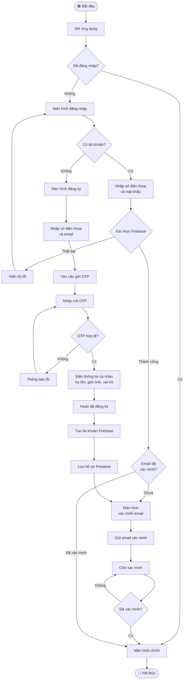

---

### 4.2 Activity – Ghi nhận và Theo dõi Sức khỏe

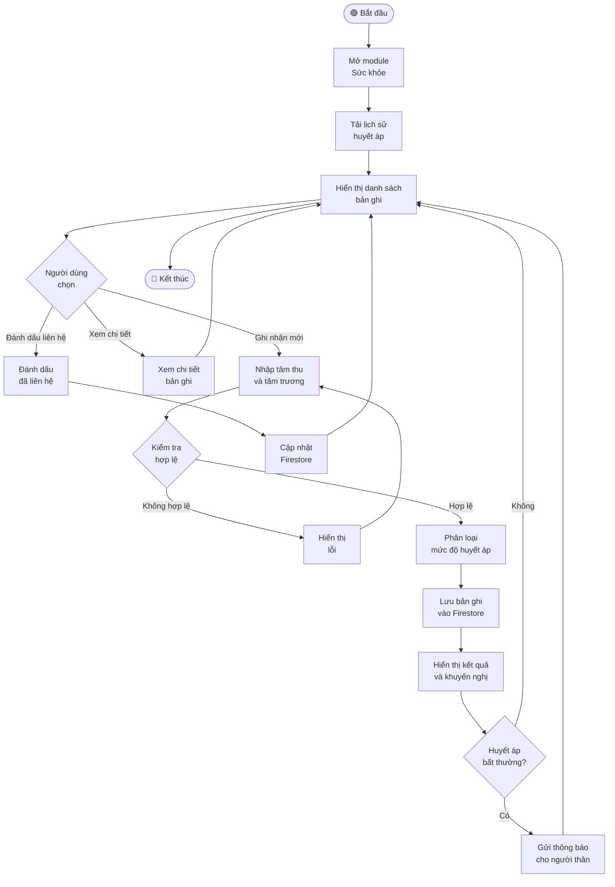

---

### 4.3 Activity – Quản lý Thuốc

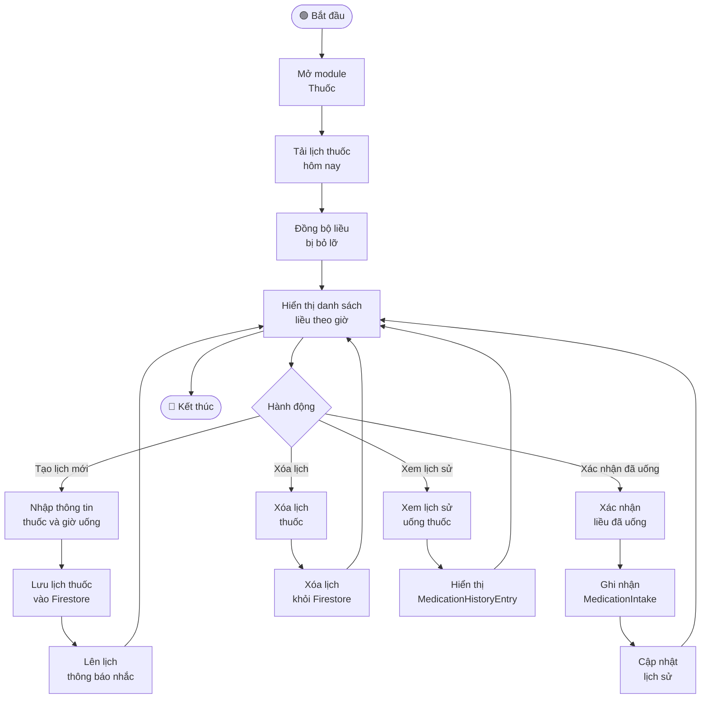

---

### 4.4 Activity – SOS Khẩn cấp

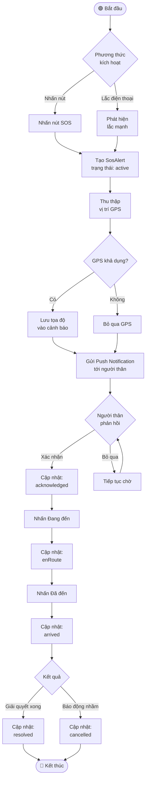

---

## 5. Biểu đồ Tuần tự (Sequence Diagram)

### 5.1 Sequence – Đăng ký tài khoản

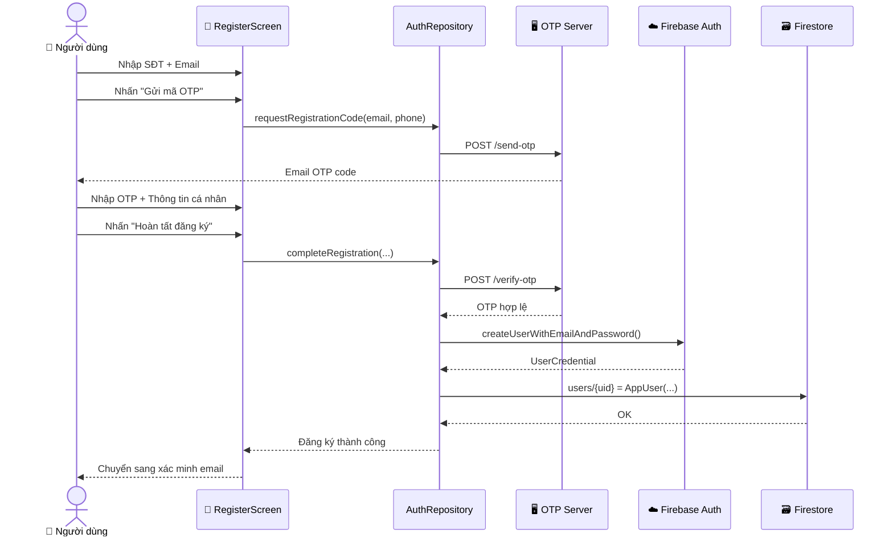

---

### 5.2 Sequence – Ghi nhận Huyết áp

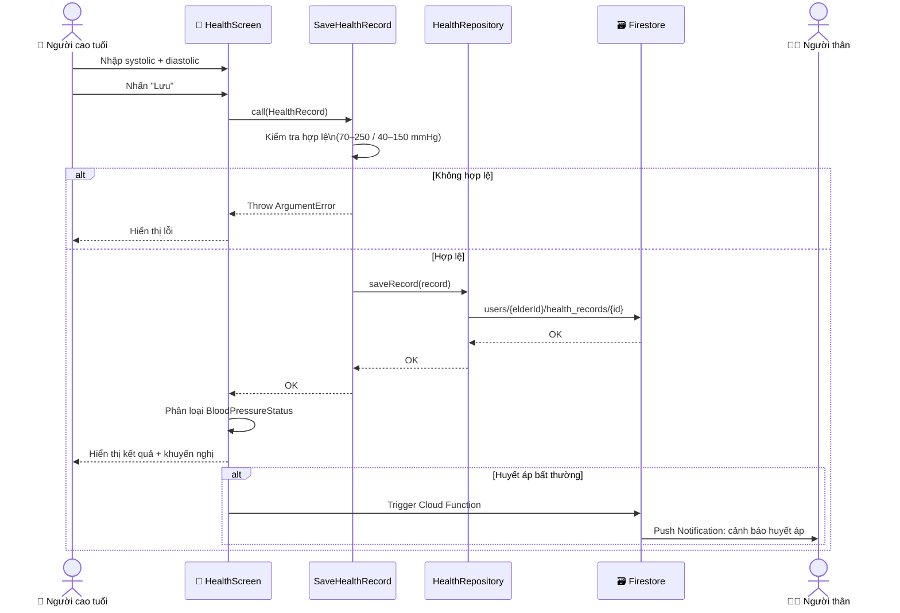

---

### 5.3 Sequence – SOS Khẩn cấp

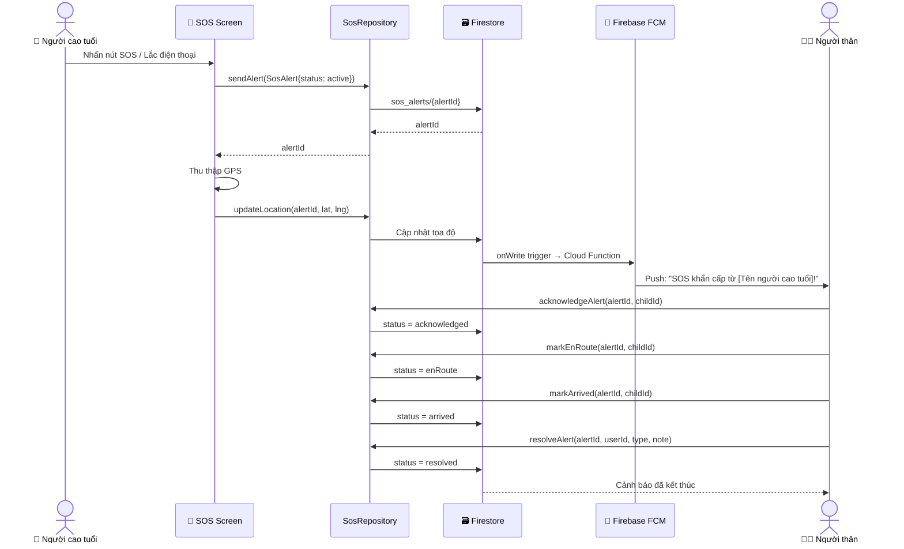

---

### 5.4 Sequence – Liên kết Tài khoản

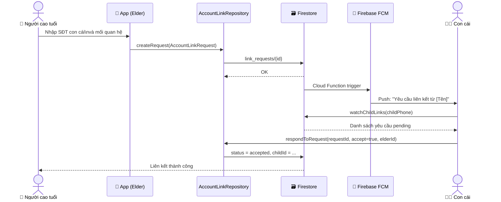

---

## 6. Biểu đồ Lớp (Class Diagram)

```mermaid
classDiagram
    direction TB

    %% ===== ENUMS =====
    class UserRole {
        <<enumeration>>
        elder
        child
        caregiver
    }

    class UserGender {
        <<enumeration>>
        male
        female
        other
    }

    class AppointmentStatus {
        <<enumeration>>
        unassigned
        assigned
        accepted
        completed
        cancelled
    }

    class SosStatus {
        <<enumeration>>
        active
        acknowledged
        enRoute
        arrived
        resolved
        cancelled
    }

    class SosTriggerMethod {
        <<enumeration>>
        button
        shake
    }

    class LinkRequestStatus {
        <<enumeration>>
        pending
        accepted
        rejected
        cancelled
    }

    class MedicationHistoryStatus {
        <<enumeration>>
        taken
        missed
    }

    class BloodPressureStatusCode {
        <<enumeration>>
        low
        optimal
        normal
        rising
        high
        crisis
    }

    %% ===== ENTITIES =====
    class AppUser {
        +String id
        +String phoneNumber
        +String fullName
        +UserRole role
        +DateTime createdAt
        +String email
        +UserGender? gender
    }

    class HealthRecord {
        +String id
        +String elderUserId
        +int systolic
        +int diastolic
        +DateTime recordedAt
        +DateTime? contactedAt
        +String? contactedById
        +bool hasBeenContacted
        +BloodPressureStatus status
        +bool isAbnormal
    }

    class BloodPressureStatus {
        +BloodPressureStatusCode code
        +String title
        +String message
        +String ctaLabel
        +int level
        +bool needsAttention
        +bool isUrgent
    }

    class PillSchedule {
        +String id
        +String elderUserId
        +String medicationName
        +String dosage
        +String instruction
        +List~int~ timesInMinutes
        +DateTime startDate
        +DateTime? endDate
    }

    class MedicationIntake {
        +String id
        +String elderUserId
        +String scheduleId
        +DateTime scheduledAt
        +DateTime takenAt
    }

    class MedicationHistoryEntry {
        +String id
        +String elderUserId
        +String scheduleId
        +String medicationName
        +String dosage
        +DateTime scheduledAt
        +DateTime? takenAt
        +MedicationHistoryStatus status
    }

    class ScheduledMedicationDose {
        +PillSchedule schedule
        +DateTime scheduledAt
    }

    class MedicalAppointment {
        +String id
        +String elderUserId
        +String title
        +String hospitalName
        +String department
        +DateTime scheduledAt
        +AppointmentStatus status
        +String createdById
        +String note
        +String? assigneeId
        +String? assigneeName
        +DateTime? createdAt
    }

    class MedicalVisit {
        +String id
        +String elderUserId
        +DateTime visitDate
        +String hospitalName
        +String department
        +String doctorName
        +String diagnosis
        +String conclusion
        +String notes
        +DateTime? followUpDate
        +String createdById
        +List~MedicalDocument~ documents
    }

    class MedicalDocument {
        +String id
        +String fileName
        +String storagePath
        +String contentType
        +String uploadedById
        +DateTime createdAt
    }

    class SosAlert {
        +String id
        +String elderUserId
        +SosTriggerMethod triggerMethod
        +double? latitude
        +double? longitude
        +double? locationAccuracy
        +DateTime? locationCapturedAt
        +SosStatus status
        +DateTime triggeredAt
        +DateTime? acknowledgedAt
        +String? acknowledgedById
        +DateTime? enRouteAt
        +DateTime? arrivedAt
        +DateTime? resolvedAt
        +String? resolvedById
        +String? resolutionType
        +String? resolutionNote
        +String? cancelledById
        +String? cancellationReason
        +bool isOngoing
        +bool isClosed
    }

    class ElderLocation {
        +String elderId
        +double latitude
        +double longitude
        +double accuracyMeters
        +DateTime updatedAt
    }

    class AccountLinkRequest {
        +String id
        +String elderId
        +String elderName
        +String elderPhone
        +String childPhone
        +String relationship
        +LinkRequestStatus status
        +DateTime createdAt
        +String? elderGender
        +String? childId
        +String? childName
        +DateTime? updatedAt
    }

    class EmergencyContact {
        +String id
        +String name
        +String relationship
        +String phoneNumber
    }

    %% ===== REPOSITORIES =====
    class AuthRepository {
        <<interface>>
        +watchUserId() Stream~String?~
        +currentUserId String?
        +currentUserEmailVerified bool
        +requestRegistrationCode(email, phone) Future~void~
        +completeRegistration(...) Future~void~
        +signInWithPhoneAndPassword(...) Future~void~
        +sendEmailVerification() Future~void~
        +reloadEmailVerificationStatus() Future~bool~
        +getProfile(userId) Future~AppUser?~
        +saveProfile(user) Future~void~
        +signOut() Future~void~
    }

    class HealthRepository {
        <<interface>>
        +watchRecords(elderId) Stream~List~HealthRecord~~
        +saveRecord(record) Future~void~
        +markAsContacted(recordId, childId) Future~void~
    }

    class MedicationRepository {
        <<interface>>
        +watchSchedules(elderId) Stream~List~PillSchedule~~
        +watchIntakes(elderId, day) Stream~List~MedicationIntake~~
        +watchHistory(elderId) Stream~List~MedicationHistoryEntry~~
        +syncMissedDoses(elderId, schedules, now) Future~void~
        +createSchedule(schedule) Future~void~
        +deleteSchedule(scheduleId, elderId) Future~void~
        +confirmTaken(...) Future~void~
    }

    class AppointmentRepository {
        <<interface>>
        +watchAppointments(elderId) Stream~List~MedicalAppointment~~
        +createAppointment(appointment) Future~void~
        +acceptAppointment(...) Future~void~
        +releaseAppointment(...) Future~void~
        +completeAppointment(...) Future~void~
    }

    class MedicalRecordRepository {
        <<interface>>
        +watchVisits(elderId) Stream~List~MedicalVisit~~
        +createVisit(visit) Future~String~
        +attachDocument(...) Future~void~
        +readDocument(...) Future~Uint8List~
        +createDocumentOpenUrl(...) Future~Uri~
    }

    class SosRepository {
        <<interface>>
        +sendAlert(alert) Future~String~
        +watchActiveAlerts(elderId) Stream~List~SosAlert~~
        +watchAlert(alertId) Stream~SosAlert?~
        +acknowledgeAlert(alertId, childId) Future~void~
        +updateLocation(...) Future~void~
        +markEnRoute(alertId, childId) Future~void~
        +markArrived(alertId, childId) Future~void~
        +cancelAlert(...) Future~void~
        +resolveAlert(...) Future~void~
    }

    class AccountLinkRepository {
        <<interface>>
        +watchElderLinks(elderId) Stream~List~AccountLinkRequest~~
        +watchAcceptedFamilyLinks(elderId) Stream~List~AccountLinkRequest~~
        +watchChildLinks(childPhone) Stream~List~AccountLinkRequest~~
        +createRequest(request) Future~void~
        +respondToRequest(...) Future~void~
        +cancelRequest(requestId) Future~void~
    }

    class ElderLocationRepository {
        <<interface>>
        +watchLocation(elderId) Stream~ElderLocation?~
        +saveLocation(location) Future~void~
    }

    %% ===== USE CASES =====
    class SaveHealthRecord {
        -HealthRepository _repository
        +call(record) Future~void~
    }

    %% ===== RELATIONSHIPS =====
    AppUser "1" --> "1" UserRole
    AppUser "1" --> "0..1" UserGender

    HealthRecord "1" --> "1" BloodPressureStatus
    BloodPressureStatus "1" --> "1" BloodPressureStatusCode

    ScheduledMedicationDose "1" --> "1" PillSchedule
    MedicationIntake "n" --> "1" PillSchedule : scheduleId
    MedicationHistoryEntry "n" --> "1" PillSchedule : scheduleId
    MedicationHistoryEntry "1" --> "1" MedicationHistoryStatus

    MedicalVisit "1" --> "0..*" MedicalDocument

    SosAlert "1" --> "1" SosTriggerMethod
    SosAlert "1" --> "1" SosStatus

    AccountLinkRequest "1" --> "1" LinkRequestStatus

    MedicalAppointment "1" --> "1" AppointmentStatus

    AuthRepository ..> AppUser : manages
    HealthRepository ..> HealthRecord : manages
    MedicationRepository ..> PillSchedule : manages
    MedicationRepository ..> MedicationIntake : manages
    MedicationRepository ..> MedicationHistoryEntry : manages
    AppointmentRepository ..> MedicalAppointment : manages
    MedicalRecordRepository ..> MedicalVisit : manages
    SosRepository ..> SosAlert : manages
    AccountLinkRepository ..> AccountLinkRequest : manages
    ElderLocationRepository ..> ElderLocation : manages

    SaveHealthRecord --> HealthRepository : uses
    SaveHealthRecord ..> HealthRecord : validates

    AppUser "1" --> "0..*" HealthRecord : elderUserId
    AppUser "1" --> "0..*" PillSchedule : elderUserId
    AppUser "1" --> "0..*" MedicalAppointment : elderUserId
    AppUser "1" --> "0..*" MedicalVisit : elderUserId
    AppUser "1" --> "0..*" SosAlert : elderUserId
    AppUser "1" --> "0..1" ElderLocation : elderId
    AppUser "1" --> "0..*" AccountLinkRequest : elderId
    AppUser "1" --> "0..*" EmergencyContact : contacts
```

---

## 7. Thiết kế Cơ sở Dữ liệu (Firestore Schema)

### Cấu trúc Firestore Collections

```
Firestore Database
│
├── users/                              # Collection: AppUser
│   └── {userId}/
│       ├── id: String
│       ├── phoneNumber: String
│       ├── fullName: String
│       ├── email: String
│       ├── role: String               # "elder" | "child" | "caregiver"
│       ├── gender: String?            # "male" | "female" | "other"
│       ├── createdAt: Timestamp
│       │
│       ├── health_records/            # Sub-collection: HealthRecord
│       │   └── {recordId}/
│       │       ├── id: String
│       │       ├── elderUserId: String
│       │       ├── systolic: Number
│       │       ├── diastolic: Number
│       │       ├── recordedAt: Timestamp
│       │       ├── contactedAt: Timestamp?
│       │       └── contactedById: String?
│       │
│       ├── pill_schedules/            # Sub-collection: PillSchedule
│       │   └── {scheduleId}/
│       │       ├── id: String
│       │       ├── elderUserId: String
│       │       ├── medicationName: String
│       │       ├── dosage: String
│       │       ├── instruction: String
│       │       ├── timesInMinutes: Array[Number]
│       │       ├── startDate: Timestamp
│       │       ├── endDate: Timestamp?
│       │       └── isActive: Boolean
│       │
│       ├── medication_intakes/        # Sub-collection: MedicationIntake
│       │   └── {intakeId}/
│       │       ├── id: String
│       │       ├── elderUserId: String
│       │       ├── scheduleId: String
│       │       ├── scheduledAt: Timestamp
│       │       └── takenAt: Timestamp
│       │
│       ├── medication_history/        # Sub-collection: MedicationHistoryEntry
│       │   └── {historyId}/
│       │       ├── id: String
│       │       ├── elderUserId: String
│       │       ├── scheduleId: String
│       │       ├── medicationName: String
│       │       ├── dosage: String
│       │       ├── scheduledAt: Timestamp
│       │       ├── takenAt: Timestamp?
│       │       └── status: String     # "taken" | "missed"
│       │
│       ├── appointments/              # Sub-collection: MedicalAppointment
│       │   └── {appointmentId}/
│       │       ├── id: String
│       │       ├── elderUserId: String
│       │       ├── title: String
│       │       ├── hospitalName: String
│       │       ├── department: String
│       │       ├── scheduledAt: Timestamp
│       │       ├── status: String     # AppointmentStatus enum
│       │       ├── createdById: String
│       │       ├── note: String
│       │       ├── assigneeId: String?
│       │       ├── assigneeName: String?
│       │       └── createdAt: Timestamp?
│       │
│       ├── medical_visits/            # Sub-collection: MedicalVisit
│       │   └── {visitId}/
│       │       ├── id: String
│       │       ├── elderUserId: String
│       │       ├── visitDate: Timestamp
│       │       ├── hospitalName: String
│       │       ├── department: String
│       │       ├── doctorName: String
│       │       ├── diagnosis: String
│       │       ├── conclusion: String
│       │       ├── notes: String
│       │       ├── followUpDate: Timestamp?
│       │       ├── createdById: String
│       │       └── documents/         # Sub-collection: MedicalDocument
│       │           └── {docId}/
│       │               ├── id: String
│       │               ├── fileName: String
│       │               ├── storagePath: String
│       │               ├── contentType: String
│       │               ├── uploadedById: String
│       │               └── createdAt: Timestamp
│       │
│       └── location/                  # Document: ElderLocation
│           ├── elderId: String
│           ├── latitude: Number
│           ├── longitude: Number
│           ├── accuracyMeters: Number
│           └── updatedAt: Timestamp
│
├── sos_alerts/                        # Collection: SosAlert
│   └── {alertId}/
│       ├── id: String
│       ├── elderUserId: String
│       ├── triggerMethod: String      # "button" | "shake"
│       ├── latitude: Number?
│       ├── longitude: Number?
│       ├── locationAccuracy: Number?
│       ├── locationCapturedAt: Timestamp?
│       ├── status: String             # SosStatus enum
│       ├── triggeredAt: Timestamp
│       ├── acknowledgedAt: Timestamp?
│       ├── acknowledgedById: String?
│       ├── enRouteAt: Timestamp?
│       ├── arrivedAt: Timestamp?
│       ├── resolvedAt: Timestamp?
│       ├── resolvedById: String?
│       ├── resolutionType: String?
│       ├── resolutionNote: String?
│       ├── cancelledById: String?
│       └── cancellationReason: String?
│
└── link_requests/                     # Collection: AccountLinkRequest
    └── {requestId}/
        ├── id: String
        ├── elderId: String
        ├── elderName: String
        ├── elderPhone: String
        ├── childPhone: String
        ├── relationship: String
        ├── status: String             # "pending" | "accepted" | "rejected" | "cancelled"
        ├── createdAt: Timestamp
        ├── elderGender: String?
        ├── childId: String?
        ├── childName: String?
        └── updatedAt: Timestamp?
```

### Sơ đồ quan hệ CSDL (ERD dạng bảng)

```mermaid
erDiagram
    USERS {
        string id PK
        string phoneNumber
        string fullName
        string email
        string role
        string gender
        timestamp createdAt
    }

    HEALTH_RECORDS {
        string id PK
        string elderUserId FK
        int systolic
        int diastolic
        timestamp recordedAt
        timestamp contactedAt
        string contactedById FK
    }

    PILL_SCHEDULES {
        string id PK
        string elderUserId FK
        string medicationName
        string dosage
        string instruction
        array timesInMinutes
        timestamp startDate
        timestamp endDate
    }

    MEDICATION_INTAKES {
        string id PK
        string elderUserId FK
        string scheduleId FK
        timestamp scheduledAt
        timestamp takenAt
    }

    MEDICATION_HISTORY {
        string id PK
        string elderUserId FK
        string scheduleId FK
        string medicationName
        string dosage
        timestamp scheduledAt
        timestamp takenAt
        string status
    }

    APPOINTMENTS {
        string id PK
        string elderUserId FK
        string title
        string hospitalName
        string department
        timestamp scheduledAt
        string status
        string createdById FK
        string assigneeId FK
    }

    MEDICAL_VISITS {
        string id PK
        string elderUserId FK
        timestamp visitDate
        string hospitalName
        string diagnosis
        string createdById FK
    }

    MEDICAL_DOCUMENTS {
        string id PK
        string visitId FK
        string fileName
        string storagePath
        string contentType
        string uploadedById FK
        timestamp createdAt
    }

    SOS_ALERTS {
        string id PK
        string elderUserId FK
        string triggerMethod
        float latitude
        float longitude
        string status
        timestamp triggeredAt
        string acknowledgedById FK
        string resolvedById FK
    }

    LINK_REQUESTS {
        string id PK
        string elderId FK
        string elderPhone
        string childPhone
        string childId FK
        string relationship
        string status
        timestamp createdAt
    }

    ELDER_LOCATION {
        string elderId PK_FK
        float latitude
        float longitude
        float accuracyMeters
        timestamp updatedAt
    }

    USERS ||--o{ HEALTH_RECORDS : "ghi nhận sức khỏe"
    USERS ||--o{ PILL_SCHEDULES : "có lịch thuốc"
    USERS ||--o{ MEDICATION_INTAKES : "xác nhận uống"
    USERS ||--o{ MEDICATION_HISTORY : "lịch sử thuốc"
    USERS ||--o{ APPOINTMENTS : "có lịch hẹn"
    USERS ||--o{ MEDICAL_VISITS : "có hồ sơ khám"
    USERS ||--o{ SOS_ALERTS : "kích hoạt SOS"
    USERS ||--o| ELDER_LOCATION : "vị trí"
    USERS ||--o{ LINK_REQUESTS : "gửi yêu cầu liên kết"
    PILL_SCHEDULES ||--o{ MEDICATION_INTAKES : "theo lịch"
    PILL_SCHEDULES ||--o{ MEDICATION_HISTORY : "theo lịch"
    MEDICAL_VISITS ||--o{ MEDICAL_DOCUMENTS : "đính kèm"
```

## 8. Thiết kế giao diện

Giao diện được tổ chức theo hai vai trò chính: **Người cao tuổi** và **Con cái/Người chăm sóc**. Cả hai dùng thanh điều hướng dưới; các màn hình chăm sóc và dữ liệu được hiển thị theo tài khoản người cao tuổi đang chọn.

### 8.1 Luồng điều hướng màn hình

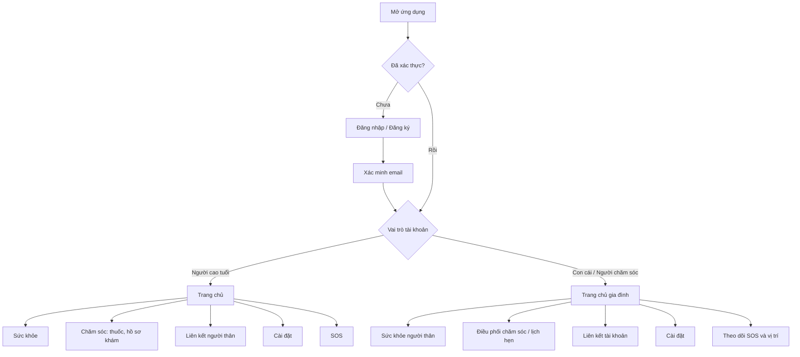

### 8.2 Phác thảo bố cục màn hình

**Người cao tuổi — Trang chủ**

```text
┌──────────────────────────────────┐
│ GeriatricCare                    │
├──────────────────────────────────┤
│ Xin chào, [Tên người dùng]        │
│                                  │
│ [Sức khỏe]       [Thuốc hôm nay]  │
│                                  │
│ [Nút SOS khẩn cấp]                │
│                                  │
├──────────────────────────────────┤
│ Trang chủ | Sức khỏe | Liên hệ | ⚙│
└──────────────────────────────────┘
```

**Con cái / Người chăm sóc — Trang chủ**

```text
┌──────────────────────────────────┐
│ GeriatricCare                    │
│ Đang theo dõi: [Chọn người thân⌄]│
├──────────────────────────────────┤
│ Xin chào, [Tên người chăm sóc]    │
│                                  │
│ [Tình trạng sức khỏe]             │
│ [Lịch thuốc]     [Lịch hẹn]       │
│ [Cảnh báo SOS / vị trí]           │
│                                  │
├──────────────────────────────────┤
│ Trang chủ | Sức khỏe | Chăm sóc   │
│ Liên kết | Cài đặt                │
└──────────────────────────────────┘
```

Các phác thảo trên thể hiện nhóm nội dung và điều hướng ở mức khái niệm. Chi tiết màu sắc, kích thước và trạng thái tương tác theo giao diện Flutter hiện có trong `lib/features/*/presentation/pages/` và `lib/app/theme/`.

### 8.3 Mã nguồn PlantUML

Các sơ đồ có bản PlantUML riêng trong [`plantuml/`](plantuml/):

| Nội dung | Tệp |
|---|---|
| Phân rã chức năng | [`01_phan_ra_chuc_nang.puml`](plantuml/01_phan_ra_chuc_nang.puml) |
| Use case | [`02_use_case.puml`](plantuml/02_use_case.puml) |
| Activity | `03_activity_dang_ky.puml` đến `06_activity_sos_khan_cap.puml` |
| Sequence | `07_sequence_dang_ky.puml` đến `10_sequence_lien_ket_tai_khoan.puml` |
| Class diagram | [`11_class_diagram.puml`](plantuml/11_class_diagram.puml) |
| ERD | [`12_database_erd.puml`](plantuml/12_database_erd.puml) |

---

*Tài liệu được tạo tự động từ mã nguồn dự án Geriatriccare - Flutter/Firebase*
*Ngày tạo: 21/10/2026*


