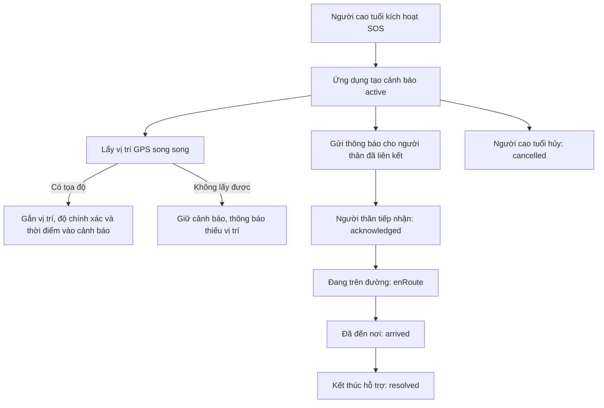

# Sơ đồ phân rã chức năng

Các chức năng của Geriatriccare được phân rã theo bảy hướng nghiệp vụ chính: tình huống khẩn cấp, lịch uống thuốc, chỉ số huyết áp, tài khoản và liên kết, thông báo, lịch khám bệnh và hồ sơ y tế.

```mermaid
flowchart TB
    A["Ứng dụng Geriatriccare"]

    A --> B["1. Quản lý tình huống khẩn cấp"]
    A --> C["2. Quản lý lịch uống thuốc"]
    A --> D["3. Quản lý chỉ số huyết áp"]
    A --> E["4. Quản lý tài khoản và liên kết"]
    A --> F["5. Quản lý thông báo"]
    A --> G["6. Quản lý lịch khám bệnh"]
    A --> H["7. Quản lý hồ sơ y tế"]

    B --> B1["Kích hoạt SOS"]
    B --> B2["Xác nhận SOS khi phát hiện rung lắc / té ngã"]
    B --> B3["Gửi cảnh báo kèm vị trí GPS"]
    B --> B4["Tiếp nhận cảnh báo và cập nhật tiến độ ứng cứu"]
    B --> B5["Hủy hoặc kết thúc cảnh báo"]
    B --> B6["Xem vị trí người cao tuổi trên bản đồ"]

    C --> C1["Tạo, chỉnh sửa hoặc dừng lịch thuốc"]
    C --> C2["Xem lịch thuốc theo ngày"]
    C --> C3["Nhận nhắc uống thuốc"]
    C --> C4["Xác nhận liều đã uống"]
    C --> C5["Ghi nhận liều bỏ lỡ và xem lịch sử"]

    D --> D1["Ghi nhận huyết áp tâm thu và tâm trương"]
    D --> D2["Kiểm tra dữ liệu và phân loại chỉ số"]
    D --> D3["Xem hướng dẫn theo kết quả"]
    D --> D4["Xem lịch sử và biểu đồ huyết áp"]
    D --> D5["Đánh dấu đã liên hệ để theo dõi"]

    E --> E1["Đăng ký và xác minh email bằng OTP"]
    E --> E2["Đăng nhập và đăng xuất"]
    E --> E3["Cập nhật hồ sơ cá nhân"]
    E --> E4["Gửi yêu cầu liên kết bằng số điện thoại"]
    E --> E5["Chấp nhận, từ chối hoặc hủy yêu cầu"]
    E --> E6["Xem tài khoản đã liên kết và chọn người cao tuổi"]

    F --> F1["Nhận thông báo SOS"]
    F --> F2["Nhận thông báo yêu cầu liên kết"]
    F --> F3["Nhận nhắc uống thuốc"]
    F --> F4["Bật / tắt thông báo khẩn cấp"]
    F --> F5["Bật / tắt nhắc uống thuốc"]

    G --> G1["Tạo lịch khám với cơ sở y tế, khoa và thời gian"]
    G --> G2["Xem danh sách và trạng thái lịch khám"]
    G --> G3["Nhận hoặc bàn giao việc hỗ trợ đi khám"]
    G --> G4["Đánh dấu lịch khám hoàn thành"]

    H --> H1["Tạo hồ sơ cho lần khám"]
    H --> H2["Lưu cơ sở y tế, bác sĩ, kết luận và ghi chú"]
    H --> H3["Xem hồ sơ và lịch sử khám"]
    H --> H4["Đính kèm và xem ảnh / PDF tài liệu y tế"]
```

## Mô-đun mã nguồn liên quan

| Hướng chức năng | Thư mục mã nguồn chính |
|---|---|
| Tình huống khẩn cấp | `sos`, `location` |
| Lịch uống thuốc | `medication` |
| Chỉ số huyết áp | `health` |
| Tài khoản và liên kết | `authentication`, `profile`, `account_linking` |
| Thông báo | `notifications`, `medication` |
| Lịch khám bệnh | `appointments` |
| Hồ sơ y tế | `medical_records` |

## Phân tích chức năng tình huống khẩn cấp

### Mục tiêu và tác nhân

- **Mục tiêu:** giúp người cao tuổi phát tín hiệu cần trợ giúp, đồng thời giúp người thân biết vị trí và theo dõi quá trình ứng cứu.
- **Người cao tuổi:** khởi tạo SOS, xác nhận hoặc hủy cảnh báo.
- **Con cái/người chăm sóc đã liên kết:** nhận cảnh báo, tiếp nhận và cập nhật tiến độ hỗ trợ.
- **Ứng dụng và dịch vụ vị trí:** tạo/lưu cảnh báo, lấy tọa độ và đồng bộ trạng thái.

### Các cách kích hoạt

1. **Kích hoạt thủ công:** người cao tuổi nhấn nút SOS. Ứng dụng tạo cảnh báo với trạng thái `active`.
2. **Phát hiện có thể bị ngã:** ứng dụng mở hộp thoại xác nhận trong 15 giây. Người cao tuổi chọn “Tôi vẫn ổn” để hủy; chọn “Gửi SOS ngay” hoặc không phản hồi đến hết thời gian thì ứng dụng tiếp tục gửi SOS.
3. **Ghi nhận phương thức kích hoạt:** cảnh báo lưu phương thức `button` hoặc `shake` cùng thời điểm phát sinh.

### Luồng xử lý và trạng thái

Các trạng thái được lưu trong ứng dụng:

- `active`: cảnh báo mới, đang chờ người thân xử lý.
- `acknowledged`: một người thân đã tiếp nhận.
- `enRoute`: người tiếp nhận đang trên đường đến hỗ trợ.
- `arrived`: người hỗ trợ đã đến nơi.
- `resolved`: sự việc đã được xử lý.
- `cancelled`: cảnh báo đã bị hủy.

Ứng dụng chỉ cho phép cập nhật trạng thái theo trình tự phù hợp. Người thân tiếp nhận khi cảnh báo còn `active`; người đã tiếp nhận mới có thể cập nhật sang `enRoute` rồi `arrived`. Cảnh báo có thể kết thúc bằng `resolved` hoặc `cancelled` tùy tình huống.

### Xử lý vị trí và lỗi

- SOS được lưu trước, còn việc lấy và gắn vị trí diễn ra song song. Vì vậy, thiếu quyền GPS hoặc không lấy được tọa độ **không ngăn việc gửi cảnh báo**.
- Ngoài vị trí kèm SOS, ứng dụng người cao tuổi còn cập nhật vị trí khi mở lại ứng dụng và định kỳ mỗi 5 phút để người thân xem vị trí gần nhất.
- Nếu người cao tuổi xác nhận “Tôi vẫn ổn” trong hộp thoại phát hiện ngã, ứng dụng không tạo SOS.
- Nếu một người thân khác đã tiếp nhận hoặc cảnh báo đã kết thúc, thao tác cập nhật tiếp theo bị từ chối và ứng dụng tải trạng thái mới nhất.

### Dữ liệu chính của cảnh báo

- Người cao tuổi tạo cảnh báo, phương thức kích hoạt và thời điểm phát sinh.
- Trạng thái hiện tại cùng thời điểm/người thực hiện các lần tiếp nhận, di chuyển, đến nơi, kết thúc hoặc hủy.
- Vĩ độ, kinh độ, độ chính xác và thời điểm lấy vị trí nếu GPS khả dụng.
- Kết quả hỗ trợ, ghi chú xử lý hoặc lý do hủy nếu có.
