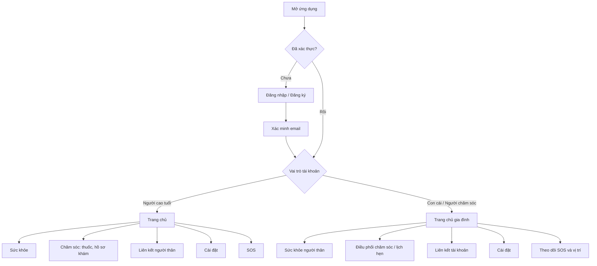

# Thiết kế giao diện

> Trích từ [tài liệu Chương 3](../chuong3_bieu_do.md).

Giao diện được tổ chức theo hai vai trò chính: **Người cao tuổi** và **Con cái/Người chăm sóc**. Cả hai dùng thanh điều hướng dưới; các màn hình chăm sóc và dữ liệu được hiển thị theo tài khoản người cao tuổi đang chọn.

### 8.1 Luồng điều hướng màn hình



### 8.2 Phác thảo bố cục màn hình

**Người cao tuổi — Trang chủ**

```text
┌──────────────────────────────────┐
│ GeriatricCare                    │
├──────────────────────────────────┤
│ Xin chào, [Tên người dùng]        │
│                                  │
│ [Sức khỏe]       [Thuốc hôm nay]  │
│                                  │
│ [Nút SOS khẩn cấp]                │
│                                  │
├──────────────────────────────────┤
│ Trang chủ | Sức khỏe | Liên hệ | ⚙│
└──────────────────────────────────┘
```

**Con cái / Người chăm sóc — Trang chủ**

```text
┌──────────────────────────────────┐
│ GeriatricCare                    │
│ Đang theo dõi: [Chọn người thân⌄]│
├──────────────────────────────────┤
│ Xin chào, [Tên người chăm sóc]    │
│                                  │
│ [Tình trạng sức khỏe]             │
│ [Lịch thuốc]     [Lịch hẹn]       │
│ [Cảnh báo SOS / vị trí]           │
│                                  │
├──────────────────────────────────┤
│ Trang chủ | Sức khỏe | Chăm sóc   │
│ Liên kết | Cài đặt                │
└──────────────────────────────────┘
```

Các phác thảo trên thể hiện nhóm nội dung và điều hướng ở mức khái niệm. Chi tiết màu sắc, kích thước và trạng thái tương tác theo giao diện Flutter hiện có trong `lib/features/*/presentation/pages/` và `lib/app/theme/`.

### 8.3 Mã nguồn PlantUML

Các sơ đồ có bản PlantUML riêng trong [`plantuml/`](../plantuml/):

| Nội dung | Tệp |
|---|---|
| Phân rã chức năng | [`01_phan_ra_chuc_nang.puml`](../plantuml/01_phan_ra_chuc_nang.puml) |
| Use case | [`02_use_case.puml`](../plantuml/02_use_case.puml) |
| Activity | `03_activity_dang_ky.puml` đến `06_activity_sos_khan_cap.puml` |
| Sequence | `07_sequence_dang_ky.puml` đến `10_sequence_lien_ket_tai_khoan.puml` |
| Class diagram | [`11_class_diagram.puml`](../plantuml/11_class_diagram.puml) |
| ERD | [`12_database_erd.puml`](../plantuml/12_database_erd.puml) |

---

*Tài liệu được tạo tự động từ mã nguồn dự án Geriatriccare - Flutter/Firebase*
*Ngày tạo: 21/10/2026*
