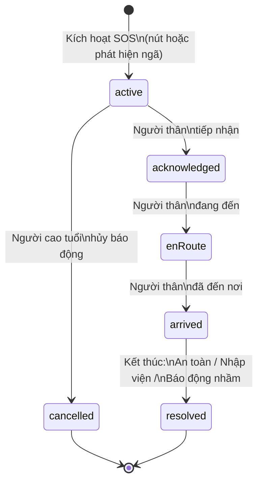
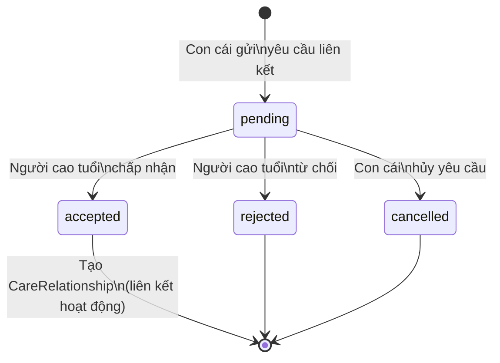

# Sơ đồ Phân rã Chức năng - Bổ sung 2 Module Còn Thiếu

> Tài liệu này bổ sung chức năng con cho **QL Tình huống khẩn cấp** và **QL liên kết tài khoản** dựa trên phân tích mã nguồn thực tế.

---

## Sơ đồ Phân rã Chức năng (Hoàn chỉnh)

```mermaid
flowchart TB
    A["Ứng dụng\nGeriatriccare"]

    A --- SOS["QL Tình huống\nkhẩn cấp"]
    A --- BP["Quản lý chỉ số\nhuyết áp"]
    A --- MED["QL lịch uống\nthuốc"]
    A --- LINK["QL liên kết\ntài khoản"]
    A --- APT["QL lịch khám\nsức khỏe"]
    A --- REC["Quản lý\nhồ sơ y tế"]

    SOS --- SOS1["Kích hoạt\ncảnh báo SOS"]
    SOS --- SOS2["Phát hiện\nngã tự động"]
    SOS --- SOS3["Gửi vị trí GPS\nkhẩn cấp"]
    SOS --- SOS4["Tiếp nhận\ncảnh báo SOS"]
    SOS --- SOS5["Cập nhật trạng thái\nhỗ trợ khẩn cấp"]
    SOS --- SOS6["Giải quyết hoặc\nhủy cảnh báo"]

    BP --- BP1["Ghi chỉ số\nhuyết áp"]
    BP --- BP2["Theo dõi lịch sử\nhuyết áp"]

    MED --- MED1["Tạo lịch\nuống thuốc"]
    MED --- MED2["Chỉnh sửa lịch\nuống thuốc"]
    MED --- MED3["Ngừng lịch\nuống thuốc"]
    MED --- MED4["Xem lịch uống\nthuốc theo ngày"]
    MED --- MED5["Nhắc lịch\nuống thuốc"]
    MED --- MED6["Ghi nhận lịch sử\ndùng thuốc"]

    LINK --- LINK1["Gửi yêu cầu\nliên kết tài khoản"]
    LINK --- LINK2["Chấp nhận hoặc\ntừ chối yêu cầu"]
    LINK --- LINK3["Xem danh sách\ntài khoản liên kết"]
    LINK --- LINK4["Hủy yêu cầu\nliên kết"]
    LINK --- LINK5["Liên hệ người thân\nqua điện thoại"]

    APT --- APT1["Tạo lịch khám\nsức khỏe"]
    APT --- APT2["Xem danh sách và\ntrạng thái lịch khám"]
    APT --- APT3["Nhận hoặc bàn giao\nlịch khám"]
    APT --- APT4["Xác nhận hoàn thành\nlịch khám"]

    REC --- REC1["Tạo hồ sơ y tế"]
    REC --- REC2["Xem hồ sơ y tế"]
    REC --- REC3["Chỉnh sửa\nhồ sơ y tế"]
```

---

## Chi tiết 2 Module Bổ sung

### Module: QL Tình huống khẩn cấp (SOS)

| STT | Chức năng | Mô tả chi tiết (từ code) |
|-----|-----------|--------------------------|
| 1 | **Kích hoạt cảnh báo SOS** | Người cao tuổi nhấn nút SOS trên màn hình để gửi cảnh báo khẩn cấp. Hệ thống tạo bản ghi `SosAlert` với trạng thái `active` và phương thức kích hoạt `button`. |
| 2 | **Phát hiện ngã tự động** | `FallDetectionService` sử dụng cảm biến gia tốc (accelerometer) để phát hiện va chạm mạnh / rơi tự do. Khi ngã được phát hiện, hiển thị hộp thoại `FallConfirmationDialog` với đếm ngược 15 giây. Nếu người dùng không phản hồi "TÔI VẪN ỔN" trong thời gian đó → tự động kích hoạt SOS (phương thức `shake`). |
| 3 | **Gửi vị trí GPS khẩn cấp** | `SosLocationService` thu thập tọa độ GPS (latitude, longitude, accuracy) và đính kèm vào cảnh báo SOS. Nếu không lấy được GPS → vẫn gửi cảnh báo nhưng không kèm vị trí, hiển thị thông báo "bật GPS cho lần sau". |
| 4 | **Tiếp nhận cảnh báo SOS** | Người thân nhận Push Notification khẩn cấp. Mở `ChildSosAlertPage` xem chi tiết: vị trí trên bản đồ Google Maps, tên và SĐT người cao tuổi. Nhấn "ĐÃ TIẾP NHẬN" → cập nhật trạng thái `acknowledged`. |
| 5 | **Cập nhật trạng thái hỗ trợ** | Quy trình tuần tự qua các trạng thái: `acknowledged` → nhấn "TÔI ĐANG ĐẾN" → `enRoute` → nhấn "TÔI ĐÃ ĐẾN" → `arrived`. Người cao tuổi nhìn thấy trạng thái cập nhật real-time. |
| 6 | **Giải quyết hoặc hủy cảnh báo** | **Người thân**: Nhấn "KẾT THÚC CẢNH BÁO" → chọn kết quả (Đã an toàn / Đã đưa đến cơ sở y tế / Báo động nhầm) + ghi chú → trạng thái `resolved`. **Người cao tuổi**: Nhấn "HỦY BÁO ĐỘNG" → trạng thái `cancelled` (nếu bấm nhầm). |

### Module: QL Liên kết Tài khoản

| STT | Chức năng | Mô tả chi tiết (từ code) |
|-----|-----------|--------------------------|
| 1 | **Gửi yêu cầu liên kết tài khoản** | Con cái mở `ChildAccountLinkingPage`, nhập số điện thoại cha/mẹ, nhấn "Gửi yêu cầu" → tạo `AccountLinkRequest` (status: `pending`). Hệ thống kiểm tra trùng lặp: nếu SĐT đã có yêu cầu pending hoặc accepted thì báo lỗi. |
| 2 | **Chấp nhận hoặc từ chối yêu cầu** | Người cao tuổi mở `ElderAccountLinkingPage`, xem danh sách "Yêu cầu liên kết đang chờ" → nhấn "Chấp nhận" hoặc "Từ chối" → cập nhật trạng thái thành `accepted` hoặc `rejected`, đồng thời tạo `CareRelationship` nếu chấp nhận. |
| 3 | **Xem danh sách tài khoản liên kết** | Cả hai phía đều xem được: Người cao tuổi xem "Người thân đã liên kết" (tên, quan hệ, SĐT, nút Gọi/Nhắn tin). Con cái xem "Đã liên kết" (tên, giới tính → hiển thị Bố/Mẹ, SĐT). |
| 4 | **Hủy yêu cầu liên kết** | Con cái có thể hủy yêu cầu đang ở trạng thái `pending` bằng nút X trên thẻ yêu cầu → gọi `cancelRequest(linkId)`. |
| 5 | **Liên hệ người thân qua điện thoại** | Người cao tuổi nhấn nút "Gọi" hoặc "Nhắn tin" trên thẻ liên hệ chính → mở trình quay số (`tel:`) hoặc ứng dụng SMS (`sms:`) với số điện thoại con cái. Bao gồm cả số khẩn cấp 115 qua `EmergencyPhoneCard`. |

---

## Sơ đồ Trạng thái SOS (State Machine)

---

## Sơ đồ Trạng thái Liên kết Tài khoản

