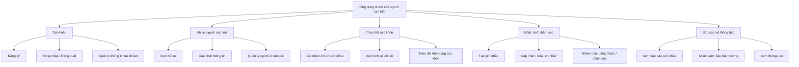
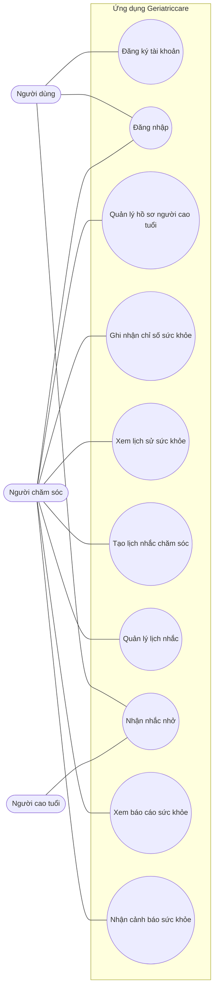

# Phân rã chức năng và danh sách Use Case

> Tài liệu phác thảo cho ứng dụng **Geriatriccare**. Nội dung dựa trên tên dự án và ngữ cảnh file `health_remote_data_source.dart`; cần đối chiếu với các màn hình và luồng thực tế trong mã nguồn.

## 1. Biểu đồ phân rã chức năng

## 2. Danh sách Use Case

| Mã | Use Case | Tác nhân chính | Mô tả |
|---|---|---|---|
| UC01 | Đăng ký tài khoản | Người dùng | Tạo tài khoản mới để sử dụng ứng dụng. |
| UC02 | Đăng nhập | Người dùng | Truy cập ứng dụng bằng thông tin xác thực. |
| UC03 | Quản lý hồ sơ người cao tuổi | Người chăm sóc | Xem và cập nhật thông tin của người được chăm sóc. |
| UC04 | Ghi nhận chỉ số sức khỏe | Người chăm sóc | Nhập chỉ số sức khỏe cần theo dõi. |
| UC05 | Xem lịch sử sức khỏe | Người chăm sóc | Xem các chỉ số đã ghi nhận theo thời gian. |
| UC06 | Tạo lịch nhắc chăm sóc | Người chăm sóc | Thiết lập lịch uống thuốc hoặc hoạt động chăm sóc. |
| UC07 | Quản lý lịch nhắc | Người chăm sóc | Sửa hoặc xóa lịch nhắc đã tạo. |
| UC08 | Nhận nhắc nhở | Người dùng | Nhận thông báo khi đến lịch chăm sóc. |
| UC09 | Xem báo cáo sức khỏe | Người chăm sóc | Theo dõi tổng quan hoặc xu hướng sức khỏe. |
| UC10 | Nhận cảnh báo sức khỏe | Người chăm sóc | Nhận cảnh báo khi chỉ số cần chú ý, nếu ứng dụng hỗ trợ. |

## 4. Ghi chú

Các chức năng ngoài theo dõi sức khỏe hiện là giả định ban đầu. Nên rà soát mã nguồn và giao diện để xác nhận tác nhân, chức năng, cùng các quy tắc nghiệp vụ trước khi dùng làm tài liệu đặc tả chính thức.

## 3. Biểu đồ Use Case

> Biểu đồ thể hiện các Use Case ở mức tổng quan. Tác nhân “Người cao tuổi” chỉ áp dụng nếu người cao tuổi trực tiếp dùng ứng dụng để nhận nhắc nhở; có thể bỏ tác nhân này nếu nhắc nhở chỉ gửi cho người chăm sóc.

